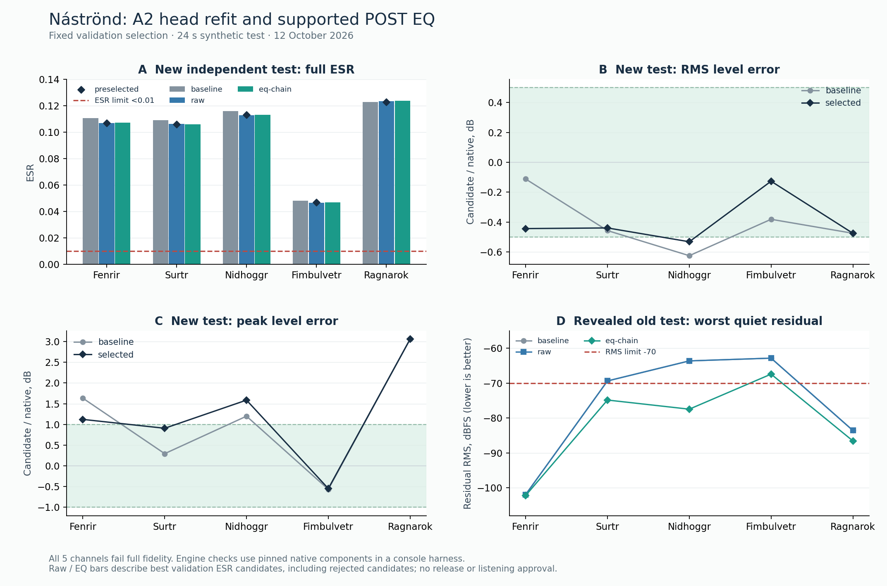
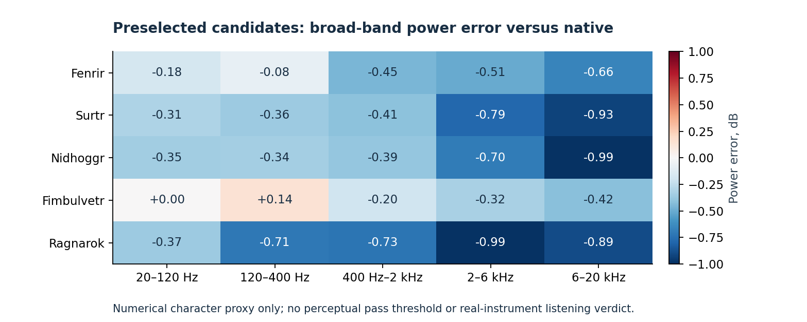

# Náströnd 음향 정확도 대안 검증 — 2026-10-12

**결론: 현재 TONE3000 경로를 유지하면서 실제로 실행할 수 있는 개선 방법은 확인됐다. 그러나 배포할 수 있는 정확도에 도달한 후보는 없다.**

기존 A2의 최종 출력 계수만 다시 적합한 방법과, 동일 A2 뒤에 TONE3000의 지원 POST EQ를 붙여 전체 출력 계수를 적합한 방법을 독립 실험으로 비교했다. 검증 데이터에서 미리 선택한 다섯 채널의 새 독립 테스트 평균 ESR은 **0.101233505 → 0.098946431, 2.2592% 감소**했다. 다섯 채널의 실제 엔진 검사는 통과했지만 **전체 음향 정확도는 0/5**, 실제 악기 청음과 GUI/DAW 승인은 미실행이며 **`release_approved=false`**다.

이는 한 개의 새 합성 입력에서 얻은 같은 입력 간 오차 감소율이다. 음색 일치율이나 통계적 유의성, 실제 연주 일반화율을 뜻하지 않는다. 2026-10-11 테스트의 평균 0.088075와 이번 새 입력의 평균 0.098946를 직접 비교해서 성능 변화를 주장해서도 안 된다.

실험은 [PR #22의 검증 소스](https://github.com/raven-deadwire/SpectralForge-Chimera-Amp-Matrix/tree/859fea9bc49c4b9981c926a314655e485c51027c)에서 분리한 `experiment/nam-alternatives-20261012` 브랜치의 이 디렉터리에만 추가했다. 기존 모델, 제품 DSP, 캡처 설정, 품질 정책과 기존 PR의 브랜치를 수정하지 않았다. 이미 완료된 5,000회 비교와 1,000회 추가 학습을 다시 실행하지 않았다.



## 1. 먼저 확인한 TONE3000 지원 범위

공식 플러그인의 로컬 모델 로더, 실제 NAM Core의 A2 판별기, 실제 `NamEngine`, `BlockEq`, `PresetFile`을 확인했다. 웹사이트의 모델 보관·검색 지원과 데스크톱 플러그인의 실제 실행 지원을 구분했다.

| 대안 | 현재 공식 플러그인에서 확인한 지원 | 이번 검증 상태 |
|---|---|---|
| A2-Full/Lite의 가중치·손실·샘플링 변경 | 고정 A2 구조를 유지하면 지원 경로에 남음 | 출력 계수 적합 후보를 실제 엔진으로 검증 |
| dilation, 층, head 길이 확장 | 로컬 A2 구조 검사에 불합격 | 실제 A2 판별기를 호출하는 콘솔 harness가 dilation 변경과 16→32 head 변경을 거부 |
| LSTM·별도 재귀 conditioner | 현재 로컬 import 지원 경로 아님 | 공식 로더 소스의 제한을 확인하고, 콘솔 harness에서 LSTM 구조 표식을 거부 |
| 임의의 `condition_dsp` 필드 | 로딩 성공만으로 실행을 보장하지 않음 | 고의로 잘못된 필드를 넣어도 출력이 원본과 bit-exact: A2 fast 경로에서 실행되지 않음 |
| `SlimmableContainer` | 지원 A2 크기 중 하나를 선택하는 컨테이너 | 임의의 직렬·병렬 DSP 그래프로 해석하면 안 됨 |
| A2 + 네이티브 POST EQ | 지원되는 프리셋 체인 | 다섯 채널에서 EQ, NAM+EQ 출력, 네이티브 프리셋 저장·복원 검증 |
| A2 + 네이티브 외부 IR | 소스에 실제 IR 로더·컨볼버가 있음 | 이번에는 전체 IR 로딩 체인을 실험하지 않음. 아래의 전처리 확인이 선행돼야 함 |
| 24 kHz 학습 + 메타데이터 변경 | 해당 로더는 모델별 SRC 없이 48 kHz 체인에서 실행 | 264 ms의 올바른 시간 문맥을 얻는 우회책으로 승인하지 않음 |

고정 A2-Full은 8채널, 23개 층과 지정된 dilation/kernel 배열, LeakyReLU 0.01, 16-tap 출력 head를 요구한다. 전체 수용 영역은 head를 포함해 **6,347샘플 = 132.229 ms의 입력 문맥**이다. 이는 처리 지연 132 ms라는 뜻이 아니다. 공개 안내의 6,332샘플 stack 수치와 전체 모델 문맥을 혼동하지 않았다.

실제 POST EQ는 6개 biquad이며 **20–20,000 Hz, ±15 dB, Q 0.1–10**을 지원한다. 양 끝은 cut/shelf, 내부 네 개는 bell이다. 이번 실험은 양 끝을 중립으로 두고 네 개 bell을 사용했다. 체인의 긴 상태는 플레이어 EQ 안에 있다. **`.nam`만 떼어 내면 같은 보정이 실행되지 않으므로 모델·EQ 설정·`.t3kpreset`을 함께 관리해야 한다.**

IR은 향후 유력한 선형 보정 후보지만, 로드된 IR 길이의 상한이 10초라는 사실만으로 정확한 전달함수가 보장되지는 않는다. 실제 로더는 trim, 길이 분류, cabinet 유형의 −18 dB pad, reverb 유형의 기본 50% mix, 에너지 정규화 경로를 갖는다. catalog의 `cab`/`space` 태그는 pad와 기본 mix를 정할 때 길이 분류보다 우선하며, 그 외 태그와 미지정 로컬 IR은 길이 기준을 사용한다. 실제 로더에서 full-wet, gain, normalization, 시간 정렬과 출력 진폭을 검증한 뒤에만 정확도 후보로 다룰 수 있다.

대상 빌드는 PR의 plugin `ef6f178ae1ac6412b55fec6f058d86e640e5aaaf`, Core `1f42f88535884450104b8711d7595019afa0495b`, JUCE `d6181bde38d858c283c3b7bf699ce6340c050b5d`에 고정했다. 2026-10-12에 확인한 공식 plugin main `ab5e5ae4388753184687d67816815aa481f2cea9`의 VERSION은 0.0.12이고 같은 로컬 A2 제한을 유지했다. 사용자의 설치 바이너리나 실제 웹 배포 버전을 확인했다는 주장은 하지 않는다.

근거: [지원 구조 감사](tone3000-support.md), [실제 import 경계 검사](gate-probe.json), [고정 빌드 및 참조 재현](native-tool-build.json), [공식 Plugin Guide](https://www.tone3000.com/guides/tone3000-plugin), [고정 로더 소스](https://github.com/tone-3000/tone3000-plugin/blob/ef6f178ae1ac6412b55fec6f058d86e640e5aaaf/plugin/src/ProcessorModelLoader.cpp).

## 2. 추가 학습으로 다룰 부분과 구조가 필요한 부분

### 파형·피크·활성 구간 오류

기존 결과의 ESR, RMS 비, peak 비로 스칼라 게인의 이론상 최적 오차를 계산했다. 다섯 채널 모두 최적 스칼라 ESR 하한이 **0.043343–0.120350**에 머물러 `<0.01`에 미달한다. Fenrir와 Ragnarök는 RMS 오차와 peak 오차를 동시에 허용 범위로 옮기는 게인 구간 자체가 겹치지 않는다. 출력 pad 하나로 두 문제를 해결할 수 없다.

이것은 파형을 바꾸는 A2 가중치 학습이 불가능하다는 증거는 아니다. 이번 출력 head 적합은 그 차이를 실제로 보여준다. Fenrir의 validation peak 오차가 **+1.500 → +0.630 dB**로 줄어 validation 레벨 항목을 통과했다. 다만 새 입력에서는 **+1.122 dB**로 다시 실패했다. 개선 가능한 요소가 있지만 아직 일반화가 충분하지 않다.

### Fimbulvetr의 bare A2 감쇠 한계

기존에 증명된 특정 테스트 구간의 quiet RMS 하한 **−68.033258 dBFS**는 그대로 유효하다. 같은 고정 A2의 epoch, crop 길이, 가중치나 출력 head만 바꿔서는 그 구간의 잔차를 −70 dBFS 이하로 낮출 수 없다. 더 긴 crop과 warmup은 최적화를 도울 수 있어도 모델의 6,347샘플 문맥을 늘리지는 않는다.

그러나 이 증명을 상태를 가진 **A2 → POST EQ** 체인에 그대로 적용할 수는 없다. 이번에는 바로 이 실제 지원 경로를 따로 검증했다.

### 무음 공진과 비선형 회복은 서로 다르다

원래 네이티브 캡처의 소스와 실제 설정에서 Fimbulvetr의 BLOOM은 내부 1.465, 공진 주파수 **153.6 Hz**, 감쇠 시정수 **62.6 ms**다. TRAIN의 132.229–500 ms 무음 감쇠를 소스에 고정된 공진 sine/cosine과 8 Hz DC pole로 설명하면, 설명되지 않는 잔여 감쇠 에너지의 비율은 **2.06×10⁻⁶**이다. 이는 해당 pole 설명 모델의 잔차이며 NAM 음향 정확도 점수가 아니다. 따라서 이 무음 구간에서는 출력 공진 보정이 타당한 출발점이다.

| 채널 | BLOOM 공진 시정수 | Sag release | Blocking recovery |
|---|---:|---:|---:|
| Fenrir | 10.24 ms | 45 ms | 21.12 ms |
| Surtr | 40.60 ms | 160 ms | 90.40 ms |
| Nidhoggr | 47.20 ms | 90 ms | 604.80 ms |
| Fimbulvetr | 62.60 ms | 300 ms | 217.44 ms |
| Ragnarök | 28.32 ms | 55 ms | 133.56 ms |

BLOOM 뒤에는 nonlinear rail도 있다. 내부 BLOOM 전달함수의 적합을 전체 활성 앰프의 정확한 선형 분해로 표현하지 않았다. 위 시정수만으로 전체 ESR의 원인을 정량 배분할 수도 없다.

근거: [학습 대안 감사](training-audit.md), [게인 가능성 진단](gain-feasibility.json), [소스 메모리 분석](memory_source_poles.json), [메모리 보정 상세](memory-methods.md), [기존 refinement 보고서](https://github.com/raven-deadwire/SpectralForge-Chimera-Amp-Matrix/blob/859fea9bc49c4b9981c926a314655e485c51027c/Tools/Nam/reports/refinement-20261011.md).

## 3. 새로 수행한 비교와 데이터 통제

기존 TRAIN 96초와 validation 24초를 복원하고 해시를 확인했다. 고정 네이티브 teacher는 `d93560445c78552768a0ed592e5ec62c3c648fb6`, 48 kHz, 4× oversampling, 원래 다섯 채널 설정이다. 8개 DSP header hash가 일치하고 재빌드한 참조의 짧은 TRAIN 접두부가 다섯 채널 모두 기존 데이터와 bit-exact임을 확인했다. 이는 참조 재현 확인이며, 완료된 전체 학습의 재실행이 아니다.

1. **Raw head 적합:** 비선형 A2 backbone을 고정하고 8×16 = 128개 출력 계수만 기존 TRAIN으로 다시 적합했다. 기존 export와 같은 zero-history 중심화를 적용했다. 입력에 따라 달라지는 DC를 구간별 평균 제거로 없애지 않았다.
2. **지원 EQ 체인 적합:** 네 개 bell의 설정을 소스 BLOOM 전달함수와 TRAIN PSD로만 한 번 적합하고 동결했다. 이후 해당 EQ를 통과한 head feature와 네이티브 출력을 적합했다. 모든 chunk와 scoring skip 이전부터 필터 상태를 이어 갔다.
3. **미리 고정한 제한된 후보군:** 각 방식에 ridge `{1e-6, 1e-4, 1e-2}`를 사용했다. 다섯 채널 × 두 방식 × 세 penalty, **총 30개 head**이며 backbone 업데이트는 0회다. 두 방식이 채널당 한 번의 TRAIN feature 계산을 공유했다.
4. **Validation 선택:** 기존 모델을 fallback으로 두고 새로 실패하는 복합 항목, 레벨·quiet 회귀를 제한한 뒤 ESR이 0.1% 이상 개선된 후보를 비교했다. 이 탐색 선택 규칙은 제품 합격선이 아니다. 이미 실패 중인 모든 active 통계가 각각 개선된다는 보장도 아니다.
5. **새 독립 평가:** 선택·모델·EQ 작업·코드·품질 정책·바이너리 해시를 봉인한 뒤 seed **2610122201**, 24초의 입력을 처음 생성했다. 기존에 노출된 seed 26101122는 고정된 회귀 진단으로만 재사용했다. 어느 테스트에서도 gain, EQ, 가중치, 정렬, 기준을 다시 맞추지 않았다.

최초 평가 실행에는 baseline 5쌍과 raw/EQ 방식별 validation 최소 ESR 후보 10쌍, 총 15쌍이 포함됐다. guarded Nidhoggr의 별도 ridge가 실행 목록에서 누락된 것을 확인해, **이미 새 입력 전에 선택된** 해당 모델 하나만 같은 입력·참조로 보충 평가했다. 나머지 네 선택 결과는 모델+작업 해시가 정확히 같은 기존 측정의 별칭으로 재사용했다. 새 테스트 이후 후보 선택이나 파라미터 변경은 없었다. 이 실행상 누락과 보충은 [별도 봉인 계획](supplement-plan.json)에 기록돼 있다.

근거: [head 적합 검토](head-refit-review.md), [동결 학습 계획](head-refit-plan.json), [선택 기록](head-refit-selection.json), [독립 테스트 계획](independent-test-plan.json), [평가기 검토](evaluator-review.md).

## 4. 다섯 채널의 새 독립 테스트 결과

아래 raw/EQ 열은 각각 validation ESR이 가장 작은 설명용 후보다. validation 레벨 guard에서 거부된 후보도 포함하므로 이 두 열을 자동 채택 목록으로 읽으면 안 된다. 최종 선택 열은 새 입력 생성 전에 고정한 선택이며, 새 테스트를 보고 변경하지 않았다.

| 채널 | 기존 refined A2 | Raw head ESR | A2→POST EQ ESR | 사전 선택 | 선택 ESR |
|---|---:|---:|---:|---|---:|
| Fenrir | 0.110451 | 0.106828 | 0.106913 | raw, λ=1e-6 | 0.106828 |
| Surtr | 0.109072 | 0.106052 | 0.105654 | EQ, λ=1e-4 | 0.105654 |
| Nidhoggr | 0.115863 | 0.112776 | 0.112833 | raw, λ=1e-2 | 0.112879 |
| Fimbulvetr | 0.047991 | 0.046332 | 0.046580 | EQ, λ=1e-4 | 0.046580 |
| Ragnarök | 0.122791 | 0.123416 | 0.123603 | 기존 모델 유지 | 0.122791 |
| **채널 단순 평균** | **0.101234** | **0.099081** | **0.099117** | | **0.098946** |

Ragnarök의 새 head 두 방식은 validation 피크 조건에서 거부됐고, 새 테스트에서는 ESR도 기존보다 악화됐다. Nidhoggr의 최소 ESR 후보 역시 validation 피크를 약간 초과해 더 강하게 정규화한 raw 후보를 사전 선택했지만, 새 입력의 레벨 정확도까지 보장하지 못했다. Fimbulvetr의 raw가 새 입력 ESR에서 EQ보다 작다는 이유로 사후 선택을 바꾸지 않았다.

### 선택한 후보의 레벨·감쇠·활성 구간

레벨 오차는 candidate/native의 부호 있는 dB다. quiet 값은 **원래 참조로 분류한 조용한 창들 중 가장 나쁜 잔차**이며, 낮을수록 좋다.

| 채널 | RMS / peak 오차 dB | Quiet RMS / peak dBFS | Active median / p95 / worst ESR | 전체 정확도 |
|---|---:|---:|---:|---|
| Fenrir | −0.443 / +1.122 | −62.278 / −45.955 | 0.072467 / 0.354725 / 0.532077 | 실패 |
| Surtr | −0.439 / +0.908 | −78.123 / −67.155 | 0.089461 / 0.324992 / 0.651971 | 실패 |
| Nidhoggr | −0.531 / +1.587 | −76.499 / −65.529 | 0.101877 / 0.373326 / 0.680522 | 실패 |
| Fimbulvetr | −0.127 / −0.548 | −78.314 / −69.045 | 0.044666 / 0.176417 / 0.440254 | 실패 |
| Ragnarök | −0.475 / +3.061 | −85.910 / −73.445 | 0.110447 / 0.552283 / 1.083420 | 실패 |

새 테스트에서 선택 후보의 레벨 통과는 **2/5**, quiet 통과는 **4/5**다. full/active ESR은 모두 실패한다. Fenrir의 worst active ESR과 Nidhoggr의 peak 등 일부 통계는 ESR 평균의 개선과 다른 방향으로 움직인다. 선택 후보 전체를 모든 지표의 개선으로 표현하지 않는다.

근거: [전체 독립 비교](independent-comparison.json), [실제 사전 선택 결과](selected-summary.json), [간결한 수치 집계](results-summary.json), [독립 재계산 검토](evaluation-independent-review.json).

## 5. 기존의 어려운 감쇠 구간에서 실제로 개선한 범위

2026-10-11 테스트는 이미 분석에 사용된 데이터다. 다음 결과는 새 독립 증거가 아니라, 동결한 후보에 대한 기존 실패 회귀 검사다. 표의 EQ는 방식별 validation 최소 ESR 후보이며 Nidhoggr는 피크 guard에서 거부된 후보라는 점을 유지한다.

| 채널 | 기존 quiet RMS / peak dBFS | 지원 EQ 체인 quiet RMS / peak dBFS | 의미 |
|---|---:|---:|---|
| Fenrir | −101.939 / −92.643 | −102.223 / −92.892 | 원래 통과하던 tail; 실질 우선순위 낮음 |
| Surtr | −69.400 / −58.321 | **−74.867 / −64.644** | 이 회귀 테스트의 quiet 두 기준 통과 |
| Nidhoggr | −63.655 / −55.276 | **−77.485 / −68.776** | quiet는 통과하나 레벨 guard에서 후보 거부 |
| Fimbulvetr | −62.864 / −54.771 | **−67.446 / −59.692** | RMS 4.582 dB 개선, 두 기준 모두 아직 실패 |
| Ragnarök | −83.593 / −71.640 | −86.578 / −76.455 | 원래 quiet가 주 문제가 아님; 새 head는 거부 |

Fimbulvetr의 새 24초 입력에서는 baseline부터 quiet를 통과했다. 이를 근거로 기존의 더 강한 실패 구간이 해결됐다고 주장하지 않았다. 고정 A2 출력 head만 바꾸는 raw 방식은 문맥 이후의 감쇠를 사실상 바꾸지 못했다.

### Oracle 진단과 실제 모델 결과의 차이

Fimbulvetr의 원래 어려운 창(시작 1,132,747, 길이 4,096샘플)에 동결 EQ를 사용하면, 역필터한 대상의 zero-history variance bound는 **−70.8285 dBFS**로 내려간다. A2가 문맥 안의 역필터 대상을 완벽하게 재현한다고 가정한 낙관적 절단 진단을 다시 EQ로 통과시키면 **RMS −71.2570 / peak −63.3477 dBFS**다.

이는 실제 학습 모델의 성적도, 임의의 모든 A2+EQ 체인에 대한 일반 하한도 아니다. **지원되는 체인이 기존 bare A2의 특정 장애를 완화할 가능성이 있다는 진단**이다. 실제 head+EQ는 위 표처럼 −67.446/−59.692에 그쳐 실패했다. 따라서 다음 합리적인 실험은 head만으로 해결됐다고 선언하는 것이 아니라, 동결 지원 필터와 전체 A2 가중치를 함께 고려한 목표 학습이다.

단일 legal bell의 제한도 확인했다. Fimbulvetr의 같은 공진 pole을 Q=10에서 맞추려면 약 +19.205 dB가 필요해 +15 dB 범위를 넘는다. 같은 주파수의 최대 legal 단일 bell 시정수는 약 49.146 ms다. 이 결과를 네 개 필터 체인이 제한된 감쇠 구간을 근사할 수 없다는 증명으로 확장하지 않는다.

근거: [원래 노출 테스트의 고정 진단](memory-factorization/revealed-witness-diagnostic.json), [적합과 한계](memory-factorization/memory-eq-factorization.json), [실제 전체 체인 비교](independent-comparison.json).

## 6. 새 비선형 장기 메모리 검사

고정 POST EQ가 무음 공진을 개선해도, 과거 연주 강도에 따라 달라지는 활성 응답까지 재현하는지는 별개다. 이를 검증하기 위해 사전에 정한 강한/약한 conditioning 뒤에 **150/250/500/750/1,000 ms** 공통 무음을 두고, 같은 probe 또는 무음을 넣었다. 두 probe 수준과 다섯 채널의 50개 비교를 구성하고 대조군을 공유해 150개 고유 네이티브 조건을 렌더했다. 자극·코드·소스·작업·분석 창과 평가 규칙을 렌더 전에 봉인했으며 적합은 하지 않았다.

같은 분석 창에서 다음 차분을 사용했다.

```text
Delta = (native[high history, probe] - native[high history, zero])
      - (native[low history,  probe] - native[low history,  zero])
```

공통 무음이 A2 문맥보다 길면, 유한 문맥 A2 뒤에 고정 선형 시불변 POST 필터를 붙인 모델의 이 차분은 정확 연산에서 0이다. 동일한 과거 필터 ringing은 대조군을 빼면서 상쇄된다. 실제 네이티브의 0이 아닌 값은 그 종류의 고정 POST 체인이 일반적으로 재현할 수 없는 history 의존성을 검출한다.

아래는 같은 낮은 probe 수준 0.03에서 **probe 전체 200 ms**의 차분 RMS다. 제품 quiet 잔차가 아니므로 −70 dBFS quiet gate를 이 표에 적용하지 않았다.

| 채널 | 150 ms 공통 무음 뒤 Delta RMS | 1,000 ms 뒤 Delta RMS |
|---|---:|---:|
| Fenrir | −46.725 dBFS | −217.369 dBFS |
| Surtr | −48.329 dBFS | −133.770 dBFS |
| Nidhoggr | **−47.207 dBFS** | **−49.804 dBFS** |
| Fimbulvetr | **−45.223 dBFS** | **−78.830 dBFS** |
| Ragnarök | **−38.748 dBFS** | −99.741 dBFS |

가장 큰 native 차분인 Ragnarök 150 ms 조건에 실제 A2+동결 POST EQ를 넣은 수치 대조는, 같은 고정 레벨 anchor를 적용하면 약 **−98.694 dBFS**였다. float32 재귀 필터의 수치 잔차와 native history 효과를 구분했다. 이 대조값을 측정하지 않은 모든 채널·모든 조건의 공통 noise floor로 사용하지 않았다.

정확 연산에서 네 개 reference와 candidate의 오차를 `e_i`라 하면 `max ||e_i|| >= ||Delta||/4`이고, 네 trace를 합친 probe-window ESR 하한은 `||Delta||² / (4 * sum ||reference_i||²)`다. 이 하한은 150 ms 조건에서 약 **0.000133–0.002207**로, 프로젝트 full ESR gate `<0.01`의 실패를 이 검사만으로 새로 증명하지 않는다. 비선형 메모리가 존재한다는 결론과, 특정 승인 기준을 넘지 못한다는 결론을 분리했다. Fimbulvetr bare A2의 기존 −68.033258 dBFS 불가능 구간은 별도의 명확한 threshold 증거다.

네 trace의 같은 창 에너지를 보완하기 위해 채널별 고정 최대 사례 4개, 총 20개 trace만 재구성하고 원래 렌더 SHA-256과 bit-exact 일치를 요구했다. 이는 새 조건, 학습 또는 후보 선택이 아니다. 원본과 anchor 적용 결과 및 재구성 기록을 모두 보존했다.

근거: [사전 계획](nonlinear-memory/plan.json), [원래 결과](nonlinear-memory/results.json), [동일 anchor·동일 창 결과와 하한](nonlinear-memory/anchored-summary.json), [메모리 상세 보고서](memory-methods.md).

## 7. 다섯 채널의 캐릭터와 실제 엔진 검증

이번 비교는 고정된 다섯 operating point에 대한 합성 자극 검사다. Fenrir의 타이트한 어택/clank, Surtr의 포화와 중역, Nidhoggr의 비대칭 grind/rot, Fimbulvetr의 bloom과 upper mids, Ragnarök의 저역 impact/punch는 원래 캡처 역할이다. 실제 악기 청음으로 이 캐릭터가 보존됐다고 승인한 것이 아니다.

수치 proxy로 20–120, 120–400, 400–2,000, 2,000–6,000, 6,000–20,000 Hz의 대역 전력, crest factor와 10개 채널 쌍의 대역 대비를 평가했다. 선택 후보의 채널 대비 평균 절대 오차는 **0.332695 → 0.281324 dB**로 줄었지만, 평균 절대 crest 오차는 **1.608373 → 1.797380 dB**로 악화됐다. “캐릭터 유지”나 “다이내믹 개선”이라는 단일 합격 판정을 내릴 수 없다.



| 채널 | 선택 후보의 관찰 | 다음 학습에서 지켜볼 항목 |
|---|---|---|
| Fenrir | 저역 오차는 줄었지만 일부 중·고역 전력 오차가 늘고 새 입력 peak가 실패 | 어택 순간 파형과 crest, quiet transition; 레벨만 맞추는 pad 제외 |
| Surtr | ESR와 어려운 tail 개선; 새 입력 peak는 +0.908 dB로 한계에 가까워짐 | 중역·고조파와 순간 envelope를 함께 확인 |
| Nidhoggr | 일부 대역 개선에도 crest/peak 악화; 1초 history 의존성 검출 | 비대칭과 동적 DC를 보존하고 회복 동작을 별도로 평가 |
| Fimbulvetr | 일부 저역·중역 정확도 개선; 기존 강한 tail 실패가 남음 | 지원 POST를 포함한 전체 학습, upper-mid 성격과 tail을 동시에 확인 |
| Ragnarök | 새 head가 부적합해 기존 유지; selected crest 오차 +3.535 dB | transient/peak·envelope가 우선, tail EQ만으로 해결하지 않음 |

### 엔진 검사의 실제 범위

- 수정하지 않은 pinned `NamEngine`, `BlockEq`, `PresetFile`을 사용하는 콘솔 harness로 16개 고유 모델/작업 쌍을 측정했다. 선택 다섯 채널은 **5/5 엔진 통과**다.
- Python A2+EQ와 실제 출력의 anchor 적용 잔차 RMS는 **−149.244~−98.267 dBFS**, 유지한 −80 dBFS parity 기준 이하다.
- 64/256 block 출력 차이와 해당 단일 NAM+EQ `.t3kpreset`의 저장·복원 출력 차이는 모두 **0**이다. 정상 상태 무음 기준도 통과했다.
- EQ 단독 검사는 native float32 계수·상태를 사용한 SciPy SOS와 다섯 채널 모두 bit-exact였다. float64 feature 적합과 실제 float32 최종 재귀 연산을 혼동하지 않았다.
- head 적합 13개, gain 진단 8개, 평가기 결함 주입 7개 검사가 통과했다. 별도 검토에서 새/기존 입력의 32개 저장 파형 기록을 재계산한 값은 보고서와 최대 차이 0이었고 main 76개·보충 91개 봉인 항목이 유지됐다.

설치된 전체 플러그인의 GUI import, DAW의 sample-rate 전환·상태복원, 실시간 callback 여유, 실제 악기 DI 및 블라인드 청음은 승인하지 않았다. 공유 CPU에서 수집한 offline timing은 실시간 인증에 사용하지 않는다. 형식·엔진 실행·수치 정확도·청음은 각각 별도 판정이다.

근거: [최종 선택 측정](selected-summary.json), [native EQ parity](memory-factorization/native-eq-parity.json), [독립 검토](evaluation-independent-review.json).

## 8. 다음 개발 단계에 적용할 순서

### 우선 1 — 고정 A2 구조의 파형·transient 학습을 분리해서 진행

이번 128계수 적합은 적은 계산으로 일부 유용한 개선과 레벨 회귀를 동시에 드러냈다. 이 코드를 재사용 가능한 진단으로 유지하고, 생산 모델에는 바로 반영하지 않는다. 기존 전체 학습에는 validation ESR만으로 best checkpoint를 고르는 부분이 있으므로, 다음 **실험용** 선택에서는 기존 fallback과 레벨·quiet guard를 함께 기록하는 현재 방식을 적용할 수 있다. 이미 실패 중인 active 지표까지 전부 좋아졌다고 읽지 않도록 각 지표도 노출해야 한다.

다음 전체 가중치 실험은 하나의 새 가설을 분리한다. Fenrir/Ragnarök에는 기존 centered waveform loss에 짧은 시간 envelope/crest 또는 transient peak 손실을 추가하는 것이 우선이다. Surtr/Nidhoggr에는 중역·고조파와 파형 위상을 동시에 유지하도록 해야 한다. 구간 평균 제거, 테스트별 gain, 참조를 바꾸는 EQ, 임의 시간 정렬로 결과를 좋게 보이게 하지 않는다. 새 목적함수·후보 수·계산 예산·sampling·validation 선택을 실행 전에 고정하고, 가능한 기존 matched control을 재사용한다. 이미 완료한 bundled official recipe와 1,000회 continuation을 이유 없이 반복하지 않는다.

### 우선 2 — 지원 POST EQ가 확인된 채널의 전체 A2 목표를 학습

Surtr와 Fimbulvetr에는 이번 legal EQ 설정을 고정한 채, A2 전체 가중치를 역필터 대상 또는 동일한 출력 체인 손실에 맞춰 적합하는 새 실험이 가장 직접적이다. 이번 head 적합은 기존 native 목표에 학습된 backbone feature를 재사용했으므로, 역필터 대상의 표현을 새로 학습하지 못했다. 이는 다음 검증할 가설이며 성공을 보장하지 않는다.

역필터 대상에 대한 MSE와 원래 native 대상에 대한 전체 체인 손실은 주파수별 가중치가 달라 같은 목적함수가 아니다. 최종 후보 선택은 변경하지 않은 native 대상과 실제 전체 체인 출력으로 평가해야 한다. 학습 crop마다 POST EQ 상태를 0으로 재설정하지 말고, 충분한 warmup 또는 연속 상태 전달을 사용해야 한다.

raw A2와 A2→EQ 전체 출력 점수를 따로 남기고, validation 선택에 모델+EQ 해시를 함께 묶는다. 이번 새 테스트도 이후에는 노출 회귀 데이터다. 다음 후보를 동결한 뒤 또 다른 독립 입력 및 실제 악기 DI로 평가해야 한다. Surtr의 peak 여유가 작고 Nidhoggr EQ의 peak가 이미 문제였으므로, tail 개선만으로 채택하지 않는다.

### 우선 3 — Fimbulvetr 선형 tail의 native IR 체인 실증

정확한 BLOOM pole을 legal EQ만으로 표현하기 어려운 부분은 native IR로 긴 선형 근사를 표현하는 대안을 검토할 수 있다. 먼저 실제 IR 로더의 전처리를 포함한 unit impulse/step·gain·full-wet·저장복원을 확인해야 한다. 이 단계가 통과하기 전에는 “TONE3000 호환 보정 모델”이라고 발표하지 않는다. 고정 IR도 선형이므로 Nidhoggr의 history에 따른 비선형 회복을 일반적으로 복구하는 대안은 아니다.

### 장기 경로 — 비선형 상태를 재현하려면 공식 실행 경로가 필요

LSTM, recurrent conditioner, 더 긴 dilation, arbitrary IIR은 연구 대안이지만 현재 확인한 공식 플러그인 A2 import 경로에서 지원된다고 가정할 수 없다. 원래 앰프의 장기 비선형 동작을 일반적으로 보존해야 한다면 공식 플레이어의 지원 확장 또는 별도의 명시적인 엔진 경로가 필요하다. 이는 TONE3000 호환 제품으로 즉시 대체할 수 있다는 의미가 아니다. 현재 호환성 요구 아래서는 지원 체인의 제한 안에서 개선한 범위와 남은 실패를 함께 유지해야 한다.

### 실제 악기 검증을 위한 구체적인 다음 입력

같은 고정 레벨로 캡처한 실제 DI의 palm mute, 강약 picking, 빠른 재발음, 저음 sustain, 150–1,000 ms 휴지 후 재어택을 다섯 채널 native와 후보에 동일하게 넣는다. 훈련·선택에 쓰지 않은 DI를 별도로 두고, 승인용 절대 레벨 측정과 청음용 level-matched 복사본을 구분한다. 블라인드 평가에서는 채널 역할, 어택, 저역 회복, decay 종료, 불필요한 노이즈를 기록한다. 청음 편의를 위한 레벨 매칭 수치를 수치 fidelity 평가에 다시 사용하지 않는다. 현재 데이터는 이 실제 악기 승인을 대신하지 않는다.

## 9. 유지한 정확도 기준과 산출물

| 항목 | 그대로 유지한 기준 |
|---|---|
| Full ESR | **<0.01** |
| Active median / p95 / worst ESR | ≤0.005 / 0.01 / 0.02 |
| Active 분류 | 고정 native reference RMS ≥−60 dBFS |
| Quiet 잔차 RMS / peak | ≤−70 / −60 dBFS |
| 전체 RMS / peak 레벨 오차 | 절대값 ≤0.5 / 1.0 dB |
| 정상 상태 무음 / 엔진 parity 잔차 | 각각 ≤−80 dBFS |
| 창 / 초기 skip | 4,096 / 6,347샘플 |

고정 source-output anchor는 Fenrir 0.09195752759643712, Surtr 0.09034985741800312, Nidhoggr 0.0860012970451488, Fimbulvetr 0.09721294970620417, Ragnarök 0.05162876564505051이다. 이것은 프로젝트 품질 정책이며 TONE3000의 공식 인증이라고 표현하지 않는다.

### 핵심 증거 위치

- 비교 결과: `independent-comparison.json`, `selected-summary.json`, `results-summary.json`.
- 적합·검증·선택: `head_refit.py`, `head-refit-plan.json`, `head-refit-validation.json`, `head-refit-selection.json`.
- 실제 엔진과 평가: `evaluate_candidates.py`, `supplement_selected.py`, `native-tool-build.json`, `evaluator-review.md`.
- 지원 필터: `memory-factorization/`의 동결 설정, source/TRAIN 적합, native parity 및 기존 witness 진단.
- 비선형 메모리: `nonlinear_memory_probe.py`, `nonlinear_memory_summary.py`, `nonlinear-memory/`의 원본·anchor 적용 결과.
- 독립 검토: `evaluation-independent-review.json`, `training-audit.md`, `head-refit-review.md`.
- 재현 그림: `summarize_results.py`가 봉인된 결과를 읽어 `results-figure.png`와 `character-bands.png`를 생성한다. 모델 선택이나 학습을 수행하지 않는다.
- 재현 순서와 경로: [REPRODUCE.md](REPRODUCE.md). 원래 입력의 식별, 동결 후보 재사용, 역사적 평가·보충 및 다음 실행의 `selected` arm을 구분한다.

큰 파형, 연구용 모델·작업·프리셋, validation projections 및 전체 해시 색인은 별도 **Nastrond-NAM-Alternatives-Evidence-2026-10-12.zip**에 보존한다. 연구용 파일은 실패 모델을 배포 승인한 패키지가 아니다. 기존 입력 archive의 SHA-256은 `4b3705e3bb515462250f6f59d8d05a96917467efd5b2bd6fdacb78a4615fb6ce`이며 기존 입력 전체를 새 패키지에 불필요하게 중복하지 않는다.

핵심 봉인:

- 사전 선택: `0f136e033c1a9d2aaf046dbc93c1c9f033c4ff3b157002f99b6ac00ba3ee6584`.
- 새 입력: `3e6196cd2773ceda1c859599356112d4d8fefd3c9dcb21ffda0b1287aafe5d1b`.
- 독립 비교: `9d59a4e599742bde7901ea0b35e2337dd5ef4902d3d17586112b92aecae501cf`.
- 실제 선택 집계: `5dd77d1c865c90953bd26e77363ad8ff8a1387e9099b5790a631385143c20c6e`.

**전체 정확도 실패는 유지한다. 임계값 하향, 제품 모델 교체, 배포·청음 승인은 수행하지 않았다.**
