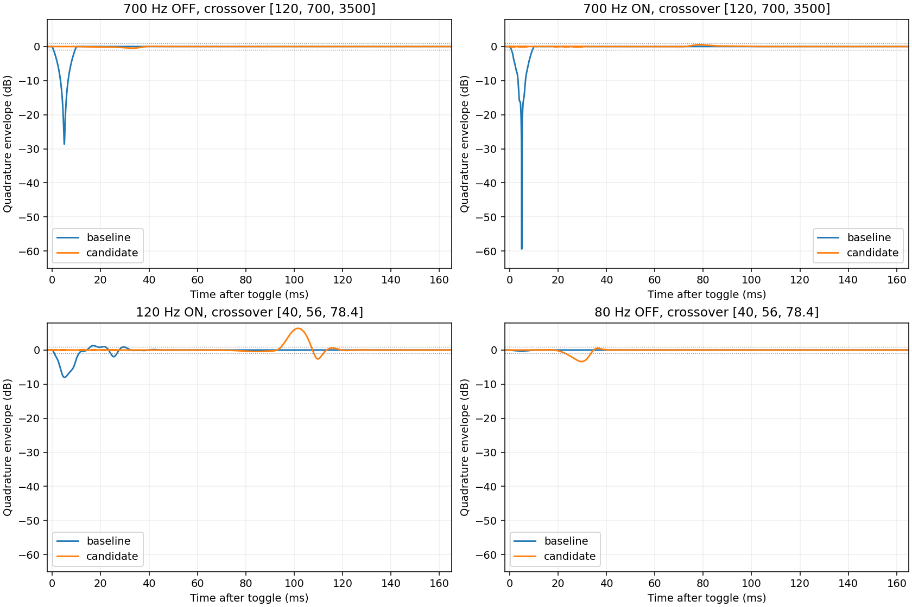

# Global ON/OFF 위상 간섭 개선 후보 — 2026-10-21 KST

**판정: 후보 구현·비교 완료 / 통합 부적합(`REJECT_CANDIDATE`) / beta.2 배포 없음.**

기본 분할의 700 Hz 감쇠는 크게 줄었지만, 저역 밀집 분할에서 새 오버슈트가 생겼다. 전환 시간·변조·클릭 대용 지표와 CPU 비용도 함께 고려하면 현재 후보를 제품에 넣을 근거가 없다. 실패를 숨기거나 기준을 낮추지 않고 독립 연구로 보존한다.

## 대상과 격리

- 기반: PR #110의 최신 확인 HEAD `3a942a125d652a234d0f481fca3af2bdf6897635`.
- 측정한 소스와 byte-for-byte 대조한 연구 코드 커밋: `1669a805f67c55acf4e3600172befd456455c7e0`.
- `Tools/experiments/MultibandBypassCandidate.h`는 기존 `Source/MultibandDynamicsCore.h`를 호출하는 오프라인 wrapper다. LR4·검출·밴드 위상 보상·Parallel Mix는 재구현하지 않았다.
- 제품 `Source/`, `Assets/`, `Installer/`, CMake 구성, 버전, beta 정책은 기반 커밋과 동일하다. 제품 타깃은 이 후보를 include하거나 선택하지 않는다.
- PR #110/main/배포 브랜치 병합 및 릴리스는 하지 않는다. 연구 workflow 성공은 재현 실행 성공일 뿐 음향 수용·배포 승인으로 사용하지 않는다.

## 후보 동작

ON 때 실제 LR4 코어를 워밍업하면서 3개의 기존 SVF allpass로 구성한 임시 경로를 near-Nyquist에서 기존 분할 주파수로 이동시킨다. 위상 이동은 100 ms, 정착 대기는 40 ms, 실제 처리로 넘어가는 마지막 혼합은 10 ms다. OFF 때는 처리 출력을 같은 위상 기준으로 10 ms 동안 걷어낸 후 allpass 주파수를 100 ms 동안 올려 원음으로 복귀한다. 분할 주파수는 log(tan(pi*f/Fs)) 공간에서 smoothstep으로 이동한다.

기본 OFF는 원음을 그대로 반환하고, 완전 OFF 종료 후에도 원음과 bit-exact다. 완전 ON은 생산 코어 출력과 bit-exact다. 추가 delay line과 host PDC는 0 samples로 유지되지만, 스위치 응답은 약 ON 150 ms / OFF 110 ms까지 길어진다. 이 응답 시간은 호스트에 보고할 고정 오디오 지연과 다르다.

실시간 allpass 주파수 이동은 위상 변조와 에너지 변화를 만든다. 정적 allpass의 flat magnitude가 이 시간 가변 경로까지 보장하지 않는다. 특히 근접한 저역 pole들이 함께 움직일 때 에너지 증가가 확인됐다.

## 측정 범위

- 44.1 / 48 / 96 / 192 kHz, 분할 4조합: 120/700/3500, 40/56/78.4, 1000/1400/1960, 7000/10000/16000 Hz.
- 기존 `multiband_response_probe.cpp`를 재사용했다. 원래 호출 형식·40 ms 출력은 유지하고 확장 호출만 20 ms 사전 구간 + 300 ms 후속 구간을 반환한다. 기존 10 ms 창 밖의 문제를 제외하지 않았다.
- 기존 176개 정적 임펄스 구성 각각 baseline/candidate를 렌더링했다(총 352 impulse renders). **176쌍 전부 샘플 단위 동일**: magnitude·phase·group delay·서로 다른 밴드 gain 및 내부 Mix 응답 보존.
- 27.5 Hz(Drop A), 30.8677 Hz(Low B), 40/55/80/120/700/3500/10000 Hz × 4 rates × 4 splits × ON/OFF = 288조건. A/B 합계 **576개 전환 기록**, 각각 독립 sin/cos mono 두 번으로 선형 중립 경로의 envelope/phase를 계산했다.
- CPU: 4 rates × mono/stereo × 32/128/512 samples × OFF/ON/toggle = 72조건, AB/BA 순서를 교대하는 5회 반복. 총 **1,222,740 callbacks**. 입력 복사는 측정 밖, setSettings/process와 clock 비용은 측정 안.
- 로컬 환경: Linux-6.18.55-x86_64-with-glibc2.39; AMD EPYC 9V74 80-Core Processor; g++ (Ubuntu 13.3.0-6ubuntu2~24.04) 13.3.0.

이는 합성 중립 신호 및 독립 코어 측정이다. 실제 기타·베이스 DI 청취, 비선형 처리 중의 음향 동등성, 설치된 DAW/드라이버, Windows/macOS 성능은 검증하지 않았다.

## 700 Hz 실패 사례 회귀

기본 분할 120/700/3500 Hz. dB 값은 원래 진폭 대비 순간 quadrature envelope의 최솟값이다.

| Fs | 기존 OFF 최소 | 후보 OFF 최소 | 기존 cold ON 최소 | 후보 cold ON 최소 | 후보 ON 최대 |
|---:|---:|---:|---:|---:|---:|
| 44100 | -28.838 dB | -0.481 dB | -50.146 dB | -0.054 dB | 0.540 dB |
| 48000 | -28.645 dB | -0.483 dB | -59.385 dB | -0.052 dB | 0.542 dB |
| 96000 | -27.840 dB | -0.499 dB | -46.536 dB | -0.041 dB | 0.563 dB |
| 192000 | -27.651 dB | -0.515 dB | -45.169 dB | -0.043 dB | 0.584 dB |

48 kHz 기존 OFF −28.645 dB / cold ON −59.385 dB를 그대로 재현했다. 후보의 기본 700 Hz는 네 rate 모두 ±1 dB 안으로 들어왔으며 회귀 assert로 유지한다. 기존 core test의 실패 특성화도 삭제·완화하지 않았다.

## 저역 및 새로운 실패

기본 분할에서 27.5/30.8677/40/55 Hz의 후보 envelope는 네 rate·양방향 모두 약 −0.125~+0.126 dB 범위였다. 그러나 40/56/78.4 Hz 밀집 분할에서는 아래 문제가 발생했다.

| 조건 | 기존 최소 / 최대 | 후보 최소 / 최대 |
|---|---:|---:|
| 48000 Hz, 80 Hz OFF | -0.278 / 0.000 dB | -3.386 / 0.511 dB |
| 48000 Hz, 120 Hz ON | -8.028 / 1.288 dB | -2.618 / 6.360 dB |
| 192000 Hz, 80 Hz OFF | -0.278 / 0.000 dB | -3.542 / 0.529 dB |
| 192000 Hz, 120 Hz ON | -8.010 / 1.288 dB | -3.073 / 6.547 dB |

전체 후보 288조건 중 **32조건이 연구용 ±1 dB envelope 기준을 위반**했다. 최악 오버슈트 +6.547 dB, 최악 최소 envelope −3.542 dB다. ±1 dB·20 ms·CPU +10%는 연구 선별 기준이며 사용자 승인 제품 규격으로 간주하지 않는다. 새 오버슈트만으로도 현재 후보는 통합 부적합이다.

## 위상·클릭 대용 지표

정착 상태의 임펄스는 bit-exact이며, 후보가 정상 상태의 위상·군지연을 바꾸지 않는다. 전환 중에는 의도적으로 위상이 이동한다. 48 kHz / 700 Hz에서 후보의 최대 순간 주파수 편차 진단값은 ON 약 93.94 Hz, OFF 약 71.71 Hz다. envelope가 거의 0인 baseline에서는 이 수치가 발산할 수 있으므로 단독 음질 점수로 비교하지 않는다.

클릭 대용 지표는 `max |z[n] - exp(jω) z[n-1]|`이며, 정상 carrier의 자연스러운 샘플 변화를 제거한 복소 first difference의 peak dBFS다(입력 진폭 0.25). 이것은 클릭을 직접 청취한 결과가 아니다.

| 48 kHz / 700 Hz | 기존 | 후보 |
|---|---:|---:|
| OFF carrier 제거 step peak | −59.651 dBFS | −52.893 dBFS |
| cold ON carrier 제거 step peak | −54.511 dBFS | −49.816 dBFS |

이 지표는 **악화**했다. 깊은 envelope notch를 줄였다는 사실만으로 클릭도 줄였다고 주장하지 않는다. 긴 phase sweep의 변조와 전환 반응 지연도 해결되지 않았다.

## CPU 비용

ON 상태 24조건의 thread CPU p50 증가율 중앙값 **+6.60%**(범위 +5.18~+8.90%). 반복 toggle 조건 중앙값 **+9.01%**, 최대 +19.58%. OFF는 처리 코어를 건너뛰지만 clock overhead 수준의 작은 값이므로 상대 %를 성능 결론으로 사용하지 않는다.

| Fs, stereo 128 samples / ON | 기존 CPU p50 | 후보 CPU p50 | 변화 |
|---|---:|---:|---:|
| 44100 Hz | 38.136 µs | 40.961 µs | +7.41% |
| 48000 Hz | 37.996 µs | 40.951 µs | +7.78% |
| 96000 Hz | 37.836 µs | 40.641 µs | +7.41% |
| 192000 Hz | 37.175 µs | 40.050 µs | +7.73% |

전체 기록에서 baseline wall deadline miss **137**, 후보 **160**; thread CPU budget 초과는 각각 **127 / 153**이다. 외부 스케줄링·공유 환경의 outlier를 제거하지 않았고, 유의한 실시간 안전성 개선으로 해석하지 않는다. p99/max/반복별 p50/개별 callback 원시 시간은 모두 보존했다. 평균·중앙값만으로 deadline PASS를 선언하지 않는다.

## 호환성 및 검증

- 생산 소스·파라미터 선언·프로젝트/A-B serializer·공장 프리셋·호스트 latency 경로는 기반 커밋과 동일하다. **5,026 prefix + 55 append, version hint 13, 기본 OFF**를 변경하지 않았다. 이 작업에서 실제 DAW의 상태 복원 시험을 새로 수행했다는 뜻은 아니다.
- 기존 `MultibandDynamicsCoreTests`: PASS. 정적 응답·위상 보상·동적 동작·밴드 선택·de-esser·무할당·700 Hz 기존 결함 특성화를 포함한다.
- 독립 후보 테스트: 네 rate × mono/stereo, default/exact OFF, active bit-exact, cold ON 실제 활성화와 endpoint, rapid reversals, crossover 자동화, block partition 1/257 일치, zero/oversized blocks, finite output, silence, 처리 중 allocation 0 PASS.
- 후보 AddressSanitizer/UndefinedBehaviorSanitizer PASS. `ASAN_OPTIONS=detect_leaks=0`이므로 LeakSanitizer 검증은 포함하지 않는다.
- 위 PASS는 계약/재현성 검사 결과다. 연구 acoustic screen은 FAIL, 청감·전체 플러그인·실제 DAW는 미검증이다.

## 재현 및 원시 증거

```sh
python Tools/measure_multiband_bypass_candidate.py --output /tmp/chimera-bypass-research
g++ -O2 -std=c++20 -ISource Tests/MultibandDynamicsCoreTests.cpp -o /tmp/mb-core
/tmp/mb-core
g++ -O2 -Wall -Wextra -Werror -std=c++20 -ISource Tests/MultibandBypassCandidateTests.cpp -o /tmp/mb-candidate
/tmp/mb-candidate
g++ -O1 -g -fsanitize=address,undefined -fno-omit-frame-pointer -std=c++20 -ISource Tests/MultibandBypassCandidateTests.cpp -o /tmp/mb-sanitize
ASAN_OPTIONS=detect_leaks=0 /tmp/mb-sanitize
```

- [수치·소스 hash·실패 조건](../Validation/MultibandBypassCandidate/measurements.json)
- [CPU callback 전체 원시 기록](../Validation/MultibandBypassCandidate/cpu-callbacks.json.gz)
- [기존 코어 로그](../Validation/MultibandBypassCandidate/core-tests.txt), [후보 계약 로그](../Validation/MultibandBypassCandidate/candidate-tests.txt), [sanitizer 로그](../Validation/MultibandBypassCandidate/sanitizer-tests.txt)
- [전환 그래프](../Validation/MultibandBypassCandidate/transitions.png)



후속 개선은 원음 복귀·정상 상태 응답·허용 전환 시간·위상 변조를 함께 제한해야 한다. 현재 100 ms allpass sweep을 단순히 더 늘리면 저역 변화량을 줄일 가능성은 있으나 스위치 반응이 더 늦어진다. 이를 검증된 해법으로 채택하지 않는다. 현재 후보를 beta.2에 포함하지 않으며, 기존 Global ON/OFF 문제는 제품 경로에서 미해결 상태로 남긴다.
