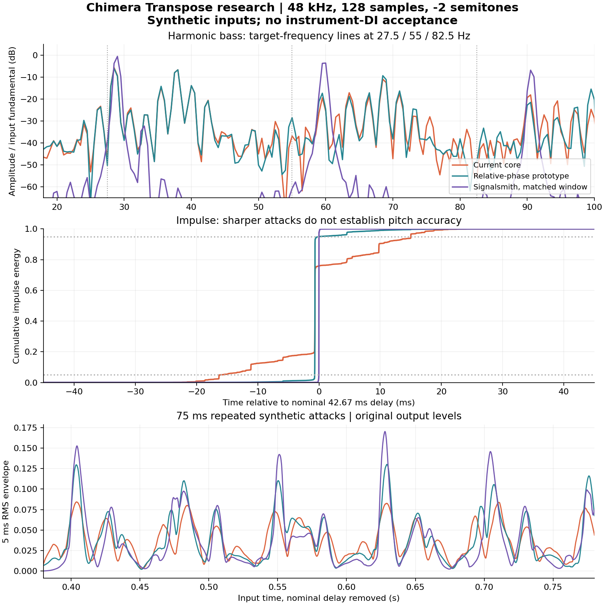

# Transpose: 베이스 저역 품질과 지연 원인 분리

2026-10-11 KST · [Issue #8](https://github.com/raven-deadwire/SpectralForge-Chimera-Amp-Matrix/issues/8)

**결론:** 현재 방식의 긴 지연과 어택 분산은 합성 입력으로 재현됐다. 같은 창을 유지한 상대 위상 잠금은 어택 분산과 반복 어택 사이 잔류음을 줄였지만, 배음이 있는 저음의 기본음 안정성은 개선하지 못했다. 짧은 가변 딜레이는 빠르게 반응하지만 목표 음정을 유지하지 못했다. 이번 후보 중 **저역 품질과 ≤10 ms를 동시에 충족해 제품에 적용할 후보는 없다.** 실제 Azhi Dahaka DI에서 문제가 해결됐다는 판정은 하지 않는다.

## 범위와 기준 소스

- 기준 main: `aa9e7b9a9f3889f1e42d83de264491e673c38018`.
- 독립 브랜치: `research/issue8-transpose-bass-lab`.
- 사용자 문서 기준 `15427d5717d30f566de27bd3dcc0eafa459a5563` 이후 현재 기준까지 `PolyPitch.h`, `GlobalDSP.h`, `PostRigGate.h`에 차이가 없음을 확인했다.
- 생산 DSP, 파라미터 ID/범위/기본값, preset/state schema, 버전, 라우팅, 릴리스 정책은 수정하지 않았다. 실험 코드는 `Tools/Transpose`의 별도 CMake 프로젝트에만 연결된다.
- 1.3.0 릴리스 준비에 이 실험을 추가 gate로 연결하지 않는다. 장기 지연/DI 목표의 미완료 상태도 바꾸지 않는다.
- 실제 DI가 없으므로 B현의 개방현·프렛·튜닝을 추정하지 않는다. 아래 B0는 30.867706 Hz의 **합성 진단 입력**이다.

## 1. Window / hop / buffer와 지연 발생 지점

`Source/PolyPitch.h::prepare/frame/process`를 직접 컴파일했다.

| Sample rate | 창 N | hop H=N/8 | 창 시간 | hop 시간 | FFT bin 간격 |
|---|---:|---:|---:|---:|---:|
| 44.1 kHz | 2,048 | 256 | 46.440 ms | 5.805 ms | 21.533 Hz |
| 48 kHz | 2,048 | 256 | 42.667 ms | 5.333 ms | 23.438 Hz |
| 96 kHz | 4,096 | 512 | 42.667 ms | 5.333 ms | 23.438 Hz |

N은 `sampleRate × .032` 이상인 첫 2의 거듭제곱이다. 입력 N-sample 링버퍼를 H마다 sine window로 분석하고, 복소 FFT의 순간 주파수를 추정한다. 출력 bin으로 magnitude/frequency를 분배한 뒤 peak locking, IFFT, 같은 window의 overlap-add를 거친다. 출력 OLA 저장소는 **2N**이지만 이것을 2N의 직렬 지연으로 더하지 않는다. inputPosition/outputPosition이 sample마다 진행하므로 host block 끝까지 기다리는 별도 FIFO는 없다. steady-state 시간 기준은 N이다.

`Source/GlobalDSP.h::Transposer`는 N-sample dry alignment를 유지한다. 이것은 wet 뒤에 다시 더하는 지연이 아니다. 활성화 때 N samples 동안 합성을 준비한 후 15 ms wet fade를 진행한다. engage에도 15 ms smoothing이 있다. 따라서 **정상 동작 지연**, **새 활성화 후 shifted-only 신호가 자리잡는 시간**, **bypass 전환 구간**을 같은 값으로 취급하면 안 된다. 신규 활성화의 wet 준비에는 N+약 15 ms가 필요하며 engage/wet 전환은 일부 겹친다.

프로세서는 `transposeon && semitones != 0`으로 실제 활성화를 결정한다. settled bypass/0에서는 pitch 추가 지연과 FFT 연산이 없다. 내부 Transposer를 직접 `enabled=true, shift=0`으로 호출하면 delayed-dry 경로가 남는 점은 기존 unit contract이며, 제품의 0-shift 호출 방식과 구별했다.

호스트에 보고하는 지연은 `postFX + engine + PRE/pedalBoard + active transpose`의 합이다. 아래 실측은 Pitch Core만의 지연이다. 오디오 인터페이스 ADC/DAC, 입출력 buffer, DAW scheduling, 전체 플러그인 지연은 측정하지 않았다. 64/128/256 samples는 48 kHz에서 각각 1.33/2.67/5.33 ms의 한 buffer 주기이며, 이것을 실측 roundtrip으로 보고하지 않는다. PDC가 실연의 고유 지연을 없애는 것도 아니다.

## 2. 신호 경로와 Gate

`PluginProcessor.cpp::processChunk`, `FXChain.h::PreFXChain`, `ChimeraDSP.h::Engine`을 조사했다.

1. input mode / Input gain → clean-input Gate detector.
2. Gate가 PRE 위치면 감쇠 → 공통 Transpose → legacy PRE 또는 pedal board.
3. Classic/Dual/Matrix 분기와 amp/cab 처리.
4. Gate가 POST-RIG 위치면 PRE+engine 지연만큼 정렬한 envelope로 감쇠 → 전체 POST.

Transpose는 분기 전 공통 처리다. Dual/Matrix에 shifter를 중복 생성하지 않는다. Matrix LOW용 clean buffer도 Transpose 뒤에서 복사되며, DI/AMP 두 경로의 공통 음정은 같다. LOW DI가 transpose를 우회해 원래 음정과 섞이는 코드 경로는 발견하지 못했다. 다만 실제 preset의 cabinet HP, band EQ, amp distortion, LOW blend는 저역에 추가 영향을 줄 수 있어 이번 core 렌더만으로 배제하지 않는다.

Gate는 peak detector의 20 ms decay, 6 dB hysteresis, 0.5 ms attack, 가변 Hold/Release를 사용한다. Release는 완전 무음까지의 시간이 아닌 시정수다. 감쇠 envelope는 nominal latency에 맞지만, **STFT가 퍼뜨린 어택 전체의 에너지 분포**까지 보존한다는 뜻은 아니다.

## 3. 재현 입력과 계측 방법

실제 생산 C++ 코어와 actual NoiseGate/PostRigGate를 JUCE 8.0.8 / GCC 13.3 Release, 공유 Linux 컨테이너에서 실행했다. 외부 후보의 정확한 소스 SHA는 [도구 설명](../Tools/Transpose/README.md)과 [환경 명세](../Validation/Transpose/2026-10-11/provenance.json)에 있다.

- 기존 27.5 Hz / L=0.2, R=-0.65L 사인 입력을 3초로 연장. 기존 1.5초 regression도 별도로 실행.
- 합성 B0 sine, B0의 8개 배음, 8개 hop phase의 impulse, 75/125 ms 간격의 16회 반복 어택, 감쇠하는 저음.
- 엔진별로 **동일 input 파일**을 사용하고 SHA-256 보존.
- 상세 103회 + 44.1/48/96 kHz × 64/128/256 × 0/±1/±2/±5/±12 × 5엔진 = 405회.
- 추가 24회 control: B0/220 Hz × R=-0.65L/동상/우측 무음 × 4엔진. 원음 oracle의 gain 및 frequency 측정 정확도도 확인.
- latency는 impulse energy centroid, smear는 5–95% energy 폭. FFT가 음정을 바꾸므로 파형 상관만으로 판정하지 않음.
- 기본음은 정확한 target 주파수의 coherent gain과 target의 0.8–1.2배 대역 에너지를 따로 측정. 전자는 detuning/warble 때문에 크게 낮아질 수 있다. 이를 전부 “저음 볼륨 손실”로 표현하지 않는다.
- warble는 complex demodulation의 6 Hz 저역통과 후 순간 주파수 p95−p5 proxy. target가 약하거나 detuned이면 단독 품질 점수로 해석하지 않는다.

## 4. 지연 실측과 음질 결과는 별개

48 kHz, block 128, −2반음, Gate off. 지연/분산은 8 impulses의 중앙값이다.

| 엔진 | Nominal 지연 | 실측 centroid | Impulse 분산 폭 | 75 ms 반복 어택 valley/peak | 판정 |
|---|---:|---:|---:|---:|---|
| 현재 PolyPitch | 42.667 ms | 42.610 ms | 31.156 ms | −9.19 dB | 기준 |
| 상대 위상 잠금 수정안 | 42.667 ms | 42.338 ms | 0.083 ms | −15.77 dB | 어택 개선, 저음 안정성 미개선 |
| Signalsmith, 같은 N/H | 42.667 ms | 42.664 ms | 0.052 ms | −21.05 dB | 어택 개선, 저음 음정 오차로 보류 |
| Signalsmith 기본 설정 | 120.000 ms | 120.002 ms | 0.031 ms | −17.91 dB | 지연 목표 불충족; 저음 정확도도 불충족 |
| 8 ms 범위의 2-head delay | 고정값 없음 | 4.024 ms | 0.021 ms | −25.19 dB | 목표 음정 불충족, 탈락 |

상대 위상 수정안의 centroid 차이 0.27 ms는 에너지 분포 변화다. **알고리즘 지연을 줄인 성과로 계산하지 않는다.** 2-head delay의 8개 centroid 범위는 2.84–5.26 ms이며, nominal=-1로 기록한다. 이를 host에 4 ms 고정 latency로 보고할 수 없다.

현재 core의 centroid는 44.1 kHz에서 46.447 ms, 96 kHz에서 42.607 ms다. 생산 Transposer wrapper도 settled −2에서는 동일하며, processor-style bypass/zero impulse는 centroid와 smear가 모두 0이다.

### 저역 fundamental와 warble

단일 합성 B0→A0에서 현재 core의 정확한 target gain은 −0.225 dB, dominant pitch 오차는 −0.22 cents다. 기존 27.5 Hz→약 24.5 Hz에서도 target gain −0.549 dB다. **단일 저음이 무조건 없어지는 현상은 이 입력에서 재현되지 않았다.**

반면 B0 8배음 입력은 다음 결과를 보였다.

| 엔진 | Fundamental 주변 대역 gain | 전체 RMS gain | 정확한 target gain | Warble proxy p95−p5 |
|---|---:|---:|---:|---:|
| 현재 | −5.25 dB | −3.54 dB | −47.55 dB | 107.93 cents |
| 상대 위상 수정 | −5.61 dB | −3.25 dB | −50.24 dB | 113.91 cents |
| Signalsmith 동일 창 | −0.26 dB | −0.27 dB | −38.96 dB | 8.75 cents |
| Signalsmith 기본 | −0.45 dB | −0.52 dB | −56.12 dB | 1.60 cents |
| 2-head delay | −0.34 dB | −0.94 dB | −62.46 dB | 16.84 cents |

현재 core는 이 합성 배음 입력에서 **저역 대역 에너지 감소와 목표 음정의 분산**을 함께 보였다. 낮은 warble proxy나 높은 대역 에너지만으로 다른 후보를 통과시킬 수 없다. 예를 들어 동일 창 Signalsmith는 B0 단일 tone에서 목표보다 약 +101 cents 높았고, 기본 설정도 약 +71 cents 높았다. 2-head delay는 약 +200 cents로 사실상 원음 주파수에 머물렀다. 이는 해당 버전/설정/입력의 결과이며 외부 라이브러리 전체에 대한 일반 평가가 아니다. 동상 및 우측 무음 control에서도 같은 저음 현상이 재현돼 단순 L/R 역상 상쇄는 배제했다.

### 반복 어택

75 ms 반복 입력의 valley/peak는 상대 위상 수정으로 −9.19→−15.77 dB, 125 ms에서는 −16.65→−25.71 dB였다. 어택 사이의 잔류 envelope가 줄었다. 그러나 이것은 synthetic separation proxy다. 더 좋은 수치를 보인 delay 대조군은 transpose 자체에 실패했다. 모든 지표를 하나의 “음질 향상” 숫자로 합치지 않는다.

## 5. 원인별 판정

| 항목 | 코드와 측정에서 확인한 사실 | 판단 / 한계 |
|---|---|---|
| Fundamental 손실 | 48 kHz 창에는 합성 B0 약 1.32주기만 포함. 배음 간격은 약 1.32 FFT bins. downshift의 낮은 source bin 일부는 DC 쪽으로 분배되어 제외되고, destination에 합쳐진 순간 주파수는 magnitude 가중 평균됨 | 인접 배음 및 양/음 주파수의 저역 lobe 간섭, bin 합류가 불안정의 유력 원인. 각 기여율을 분해한 ablation은 아직 없음 |
| 에너지 보정 | 기존 downshift low-bin 보정이 이미 존재. frame 전체 FFT energy만 정규화 | 총 에너지 보정은 fundamental별 에너지·위상 보존을 보장하지 않음. 기존 수정 재발견을 신규 개선으로 계산하지 않음 |
| Transient smear | 현재 synthesis는 `peak phase − π(N−1)/N × bin offset`으로 고정 phase ramp 사용. mapped source phase 관계는 지속적인 synthesis locking에 사용하지 않음 | 상대 source phase로 바꾼 같은 창 실험에서 smear가 크게 줄어, 이 규칙이 어택 분산에 기여함을 확인. 전체 bass 품질 원인을 이것 하나로 단정하지 않음 |
| 반복 어택 분리 | 현재 envelope valley가 높고 위상 수정으로 감소 | 원래 DI의 연주간격·뮤트·slide는 미확인 |
| Warble | 단일 저음은 안정적이지만 배음 저음은 넓은 frequency/amplitude modulation. 상대 위상만 바꿔도 남음 | 순간 주파수 추정, peak 선택/합류 등까지 개선 범위 확장 필요 |
| Gate 간섭 | 기본값과 Gate off의 이번 loud synthetic riff 차이는 valley/peak 기준 0.01 dB 미만. decay의 0.8–1.2 s tail RMS도 사실상 동일 | 이 입력에서는 Gate가 주요 원인이 아님. 사용자 DI의 입력 레벨과 설정으로 일반화 불가 |
| 강한 Gate | −24 dB / Release 5 ms / Hold 0에서 저음 꼬리가 수치상 바닥까지 잘림. −36/60/15는 tail 약 0.2 dB 감소 | Gate는 저역 본체 손실을 추가로 만들 수 있음. 당시 설정 확보 후 같은 DI로 분리 필요 |

## 6. 후보 비교와 다음 우선순위

1. **현재 엔진의 품질 개선을 우선:** 같은 창에서 source-relative phase와 transient 처리를 연구하되, low partial의 peak tracking과 frequency mapping을 함께 수정한다. 이번 단순 상대 위상 교체는 생산 적용하지 않는다. frame 전체 phase reset 역시 저음 sustain을 끊을 수 있어 bin/partial 단위 검증이 필요하다.
2. **저지연 구조는 별도 검증:** 비대칭 분석/합성 창, causal sinusoidal/transient 분리, 신뢰도에 따른 partial tracking 등이 연구 후보다. 낮은 음의 과거 관측과 짧은 출력 대기를 분리해야 하며, prediction 오차·note change·slide·chord·stereo를 검증해야 한다. 긴 저역 경로와 짧은 고역 경로를 단순 합치면 경로 정렬 때문에 지연이 다시 길어질 수 있다.
3. **외부 저지연 reference:** Signalsmith Compose는 공식적으로 typical 5–10 ms를 제시한다. Stretch와 다른 제품이며 이번에 실행하지 않았다. 평가본/SDK로 동일 DI와 고정 입력을 비교할 대상이지 Chimera의 달성 수치가 아니다.
4. **우선순위 낮음:** Rubber Band LiveShifter는 공식 문서에서도 설정에 따라 50 ms 이상이라고 설명한다. 좋은 품질 비교 후보가 될 수 있어도 ≤10 ms 해결책으로 간주하지 않는다. PSOLA/WSOLA는 저음 period 추정과 반복 접합, polyphonic fallback 비용을 포함해 봐야 한다. 8 ms 2-head 대조군처럼 빠른 응답만으로 선정하지 않는다.

공식·1차 자료:

- [Signalsmith Stretch API/latency](https://github.com/Signalsmith-Audio/signalsmith-stretch/tree/a670068d9aeb64913331d5cc29337b19a457a7df): inputLatency+outputLatency를 모두 포함했다. upstream 기본 설정은 이번 소스에서 120/30 ms다.
- [Signalsmith Compose](https://compose.signalsmith-audio.co.uk/): 공급자 설명이며 이 보고서의 실측 아님.
- [RubberBandLiveShifter](https://breakfastquay.com/rubberband/code-doc/classRubberBand_1_1RubberBandLiveShifter.html): 고정 block API, getStartDelay, 50 ms 이상이라는 제한.
- [Röbel, DAFx 2003](https://www.dafx.de/paper-archive/2003/pdfs/dafx32.pdf): spectral-bin 수준 transient 판정과 phase 재초기화 연구.
- [Polak/Erkut, DAS-DAGA 2025](https://pub.dega-akustik.de/DAS-DAGA_2025/files/upload/paper/635.pdf): STN 분리의 참고 사례. 논문 제목은 low-latency이나 보고된 최대 latency는 166.1 ms이고 자체 평가에서도 reference보다 낮은 품질이어서 ≤10 ms 근거로 사용하지 않는다.

## 7. 검증 결과와 남은 gate

**완료한 로컬 검증**

- 기존 `PitchRegressionTests`, `StabilityTests`, `GateTests`: **3/3 PASS**. 기존 assertion/fixture 수정 없음.
- bypass/zero, 재진입·ratio 변경·outgoing OLA tail, warm history, mono/stereo, 비표준 block size, Gate Full/Range, envelope 정렬과 POST tail의 기존 검사 유지.
- 405-row matrix에서 각 engine/rate/shift의 64/128/256 partition별 출력 SHA는 모두 동일. 이것은 block partition 일치이지 품질 PASS가 아니다.
- Source, Assets, root CMake, release workflow, factory/state 파일 변경 없음. 따라서 이 브랜치가 생산 라우팅/프리셋을 바꾸지 않는 것을 diff로 확인. **실험 후보가 전체 프로세서/실제 호스트의 state recall을 통과했다는 뜻은 아니다.**

48 kHz / 128 / −2의 한 번의 실행에서 current core mean/p95/p99는 166.4/398.3/424.6 µs, 해당 1,125 callbacks의 nominal deadline miss는 0이었다. 그러나 전체 matrix에는 baseline 317회, 상대 위상 363회, Signalsmith 동일 창 17회, 기본 설정 744회, delay 대조군 2회의 miss 관측이 있다. 공유 컨테이너 부하와 frame 단위 FFT burst를 분리하지 못했다. **CPU/real-time acceptance는 미완료**이며 “전체 miss=0”으로 보고하지 않는다. raw records에 모든 조합의 mean/p95/p99/max/count가 있다.

**미완료 / 실제 자료 필요**

- Azhi Dahaka 해당 구간의 isolated bass DI, 정확한 tuning/fret/입력 레벨, 사용 preset, Gate 위치·Threshold/Hold/Release, sample rate/buffer.
- 동일 DI Gate off/pre/post의 레벨을 맞춘 청취. note body, 빠른 반복 어택, sustain/slide, noise와 코드 분리.
- guitar/bass polyphonic·alternate picking·뮤트, 실제 amp/cab chain, 저튜닝 전 범위.
- Windows VST3 Studio One/Cubase/Sonar의 PDC/automation/project recall/종료, controlled callback p95/p99/30분 soak.
- 후보를 제품에 연결하기 전 fixed latency 계약, bypass transition, preset schema 보존, Matrix LOW와 parallel-lane alignment 재검증.

## 증거와 재현

- [실험 빌드 및 metric 정의](../Tools/Transpose/README.md)
- [상세 103회](../Validation/Transpose/2026-10-11/detail.json)
- [matrix 405회](../Validation/Transpose/2026-10-11/matrix.json)
- [oracle 및 stereo control 24회](../Validation/Transpose/2026-10-11/controls.json)
- [native CTest 원본 출력](../Validation/Transpose/2026-10-11/ctest.log)
- [모든 native assertion/측정 출력](../Validation/Transpose/2026-10-11/LastTest.log)
- [소스·환경·실행 파일 식별](../Validation/Transpose/2026-10-11/provenance.json)

입력/출력 WAV는 재현 도구로 다시 생성할 수 있다. 측정 파일의 `SYNTHETIC_ONLY_NOT_RELEASE_ACCEPTANCE` 상태를 유지한다. Issue #8은 닫지 않는다.
