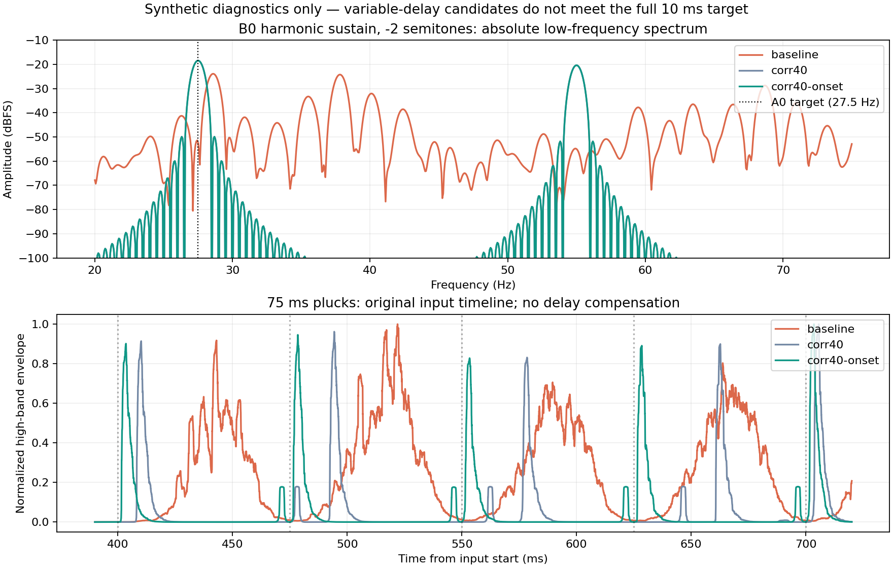

**SpectralForge Chimera Transpose 독립 DSP 구현·실측 — 2026-10-18 KST**

**판정: 10ms 목표 미달. 제품 교체·릴리스 승인 없음.** 독립 C++ 상관 접합 엔진을 구현해 저음 기본 주파수와 일부 반복 어택을 개선했다. 그러나 약한 어택에서 최대 34.60ms 추가지연이 남고, 고정 PDC 계약도 없다. `corr40-onset`은 후속 연구 기준으로만 보존한다.

측정한 native 소스는 `f2fa6acb63e272cfbbdce4ce06c50d24eefc59a0`이다. 이 커밋의 DSP/프로브/테스트를 실행했다. 후속 커밋은 수집 도구와 이 보고서·실행 근거를 추가한다. 기준 공개 제품은 [v1.3.2-beta.1](https://github.com/raven-deadwire/SpectralForge-Chimera-Amp-Matrix/releases/tag/v1.3.2-beta.1), 제품 소스 `3bec6c70a50bbb4021dcc6133f37e0c2fb3e9e58`이다. 작업 시작 main `ec6fd639e2958d34605bfb04bb81ca02c1cfb38f`는 공개 제품과 생산 코드가 같고 기존 publication policy만 달랐다. 이번 작업은 그 정책을 변경하지 않는다.

기존 연구는 다음과 같이 회수·대조했다. **아래 자체 실험을 Neural DSP 원본 측정 결과로 바꾸어 부르지 않는다.** 관련 PR/브랜치·커밋 검색, 이전 대화 검색, Transpose 관련 저장 파일 검색에서 Neural DSP의 원본 입출력 WAV, 제품 버전·설정·해시가 연결된 외부 동작 측정표를 확보하지 못했다. 자료가 어디에도 없다는 단정은 아니다. 이 환경에는 원본 플러그인 및 실행 가능한 Windows 측정 세션도 제공되지 않았다.

| 확보 자료 | 실제 내용 / 상태 |
|---|---|
| 공개 `Source/PolyPitch.h` | STFT, `latency()==size`, 44.1/48kHz에서 2048 samples, 96kHz에서 4096 samples. PR #45 기준과 blob `8149d7201376f8b4e6cdf89308be9e03e8fb40fe`가 동일하다. |
| `Chimera_Transpose_P0_Design_Evidence.zip` | 2026-10-04 자체 합성 프로브와 설계. FFT 절반 축소는 저역 손실을 보였고 48kHz 21.33ms로도 목표 미달. Neural DSP 측정 아님. |
| [PR #45](https://github.com/raven-deadwire/SpectralForge-Chimera-Amp-Matrix/pull/45), `ff9ca84c1cb53eaf7a054965ec4eee5e084aa60f` | 실제 생산 엔진, 상대 위상, Signalsmith 및 단순 가변 딜레이의 자체 비교. 상대 위상만 바꾸면 어택 분산은 줄지만 기음/음정 문제와 42.7ms 지연은 남는다. |
| `Chimera_Transpose_Comparison_2026-10-13.zip` | PR #45 후속 77회 native 렌더. 4096 분석/384 합성 후보의 임펄스 중심 8.688ms, B0 −2 중심 오차 +1.857 cents, warble 94.861 cents. −1반음 +59.525 cents 등으로 미통과. 실제 DI/DAW 및 Neural DSP 원본 측정 없음. |

회수 ZIP SHA-256: P0 패키지 `207c25d509f36f2506c67035cb6c92655c17d68f13c0f2d795671e0306a888b2`, 10월 13일 패키지 `96e609f22feba0b54a43f80d97483628db5bcec0558c9ed655a85ebf00c27a3e`.

[Neural DSP 공식 Gojira X 페이지](https://neuraldsp.com/plugins/archetype-gojira)에서 확인 가능한 것은 ±12반음 Transpose 기능이다. 이 페이지로 특정 지연 수치나 내부 알고리즘을 입증할 수 없다. 새 구현의 기술 출발점은 공개된 resampling·ring buffer·waveform similarity 개념이다. [Haghparast/Penttinen/Välimäki, DAFx 2007](https://dafx.labri.fr/main/papers/p007.pdf)은 단음 신호에서 접합점 탐색과 저주파 주기·지연의 관계를 설명한다. 이 연구는 독자적인 정규화 제곱 오차, IIR 검출, 탐색 범위, 스테레오 결합, crossfade 및 onset 규칙을 작성했다. Neural DSP 코드·디컴파일 산출물·독점 알고리즘은 사용하지 않았다. JUCE와 기존 Chimera 코드는 빌드 의존성과 비교 기준으로 사용했다.

| 실행 엔진 | 구현 및 용도 |
|---|---|
| `baseline` | 공개된 실제 `PolyPitch.h` 그대로 컴파일. |
| `relative` | PR #45 상대 위상 제어군 그대로. 새 개선으로 계산하지 않음. |
| `corr10` | 2~10ms 범위의 가변 읽기 위치, 12ms 과거 유사도 창, 2ms crossfade. 읽기 위치 상한이 실제 지연·정확한 음정 보장을 뜻하지 않음. |
| `corr40` | 같은 독립 엔진의 40ms 탐색형. 지속 저음의 주기 접합을 허용하지만 지연이 달라짐. |
| `corr40-onset` | 40ms 엔진에 downshift 전용 onset 재설정 추가. 0.3ms 빠른 에너지, 1ms 과거 peak 기준, 60ms peak decay, 2.5배 임계값, 45ms 재검출 대기. 원음 tonal attack을 통과시키지 않고 전체 파형을 재표본화함. upshift에는 이 reset을 적용하지 않음. |

한 번의 실패도 보존했다. 처음 사용한 짧은 평균 에너지 검출기는 지속 배음음을 3초 동안 47번 새 어택으로 오인했고, 목표보다 약 +200 cents인 출력으로 되돌아갔다. [실패 소스·결과](evidence/transpose-correlation-20261018/rejected-first-onset/results.json)를 남겼다. 최종 delayed-peak 검출기는 같은 지속음에서 시작 어택 한 번만 감지했다. 이 수정은 강약·지속음 위의 작은 어택 검출을 모두 해결하지 않는다.

**48kHz / block 128 / B0 → A0(−2반음), Gate off의 최종 합성 측정**이다. 8배음 B0 입력의 목표 기음은 27.5Hz이다. 아래 소수점 정밀도는 합성 신호의 계측값이며 실제 악기의 정확도를 뜻하지 않는다.

| 엔진 | 기음 인근 최대 성분 오차 (cents) | 정확한 목표 기음 성분 gain (dB) | 기음 주변 대역 gain (dB) | warble proxy 폭 (cents) | 임펄스 중심 중앙값 (ms) | 임펄스 5–95% 분산 중앙값 (ms) |
|---|---:|---:|---:|---:|---:|---:|
| baseline | +67.55 | −47.55 | −5.25 | 107.93 | 42.610 | 31.156 |
| relative | +551.02 | −50.24 | −5.61 | 113.91 | 42.338 | 0.083 |
| corr10 | +200.01 | −31.09 | −0.02 | 53.78 | 6.368 | 0.021 |
| corr40 | <0.01 | <0.01 | <0.01 | 0.30 | 12.268 | 0.021 |
| corr40-onset | <0.01 | <0.01 | <0.01 | 0.30 | 2.539 | 0.021 |

`corr10`은 주변 저역 에너지가 남아 있어도 음정이 틀리므로 탈락이다. 정확한 목표 성분과 넓은 저역 에너지를 따로 기록하는 이유다. 약한 기본음 입력에서도 최종 후보의 목표 gain 오차는 0.01dB 미만, warble proxy는 1.55 cents였으나 실제 DI 보존을 입증한 결과는 아니다. 목표 성분이 거의 사라진 baseline/relative의 warble proxy는 독립적인 청감 점수로 해석하지 않는다.

**어택 지연의 조건 의존성 때문에 10ms 성공으로 처리할 수 없다.** 동일 입력의 고역 에너지 peak 시점과 출력 peak 시점 차이를 사용했다. 따라서 아래 수치는 raw onset→output peak 시간에서 입력 자체의 약 1ms 어택 편향을 뺀 값이다. ADC/DAC·호스트 버퍼·전체 제품 왕복 지연은 포함하지 않는다.

| 합성 입력 / 추가 어택 지연 | baseline | corr40 | corr40-onset |
|---|---:|---:|---:|
| 일정 세기 75ms 반복 피킹, 중앙값 | 38.27ms | 21.04ms | 2.49ms |
| 일정 세기 75ms 반복 피킹, 최대 | 47.90ms | 36.73ms | 2.88ms |
| 강/약 교대 피킹, 최대 | 45.44ms | 30.81ms | **12.10ms** |
| 지속음 위의 작은 고역 어택, 최대 | 47.71ms | 34.31ms | **34.60ms** |

75ms 반복 피킹의 고역 valley/peak는 baseline −9.98dB → corr40 −31.45dB → 최종 후보 −43.98dB로 분리됐다. 이는 1–8kHz 어택 envelope의 수치이며, 저역 바디 전체의 분리도나 청음 통과를 대신하지 않는다. 최종 후보는 일정 피킹 16개를 모두 감지했지만 강/약 교대에서는 8개, 지속음 위의 작은 marker 조건에서는 초기 onset 1개만 감지했다. 약한 어택이 기존 가변 지연 경로를 따라 늦어지는 것이 직접 관측됐다. 단일 임펄스 2.539ms 또는 일정한 강한 피킹 2.88ms만 골라 알고리즘 전체가 10ms라고 보고하지 않는다.

위 그림의 스펙트럼은 절대 레벨, 아래 timing 패널만 개별 peak로 정규화했다. 시간축에서 임의 delay compensation을 하지 않았다. 합성 pluck에는 명시적인 tail cutoff가 있으므로 cutoff의 고역 edge까지 포함한다.

**CPU 비용은 native core의 실제 Linux thread CPU 시간과 wall time을 분리했다.** Intel Xeon Platinum 8573C 공유 컨테이너, GCC 13.3 `-O2 -DNDEBUG`, JUCE 8.0.8. 48kHz stereo / −2 / 합성 riff75를 네 번 반복한 12초 입력, 각 block별 5회, 엔진 순서를 정방향/역방향으로 교대했다. 다른 빌드·검증 작업은 dedicated timing 시작 전에 종료했다. clock 계측 비용을 빼거나 지연 outlier를 제거하지 않았다. p95/p99는 처음 0.5초 이후, miss와 max는 전체 실행에 대한 값이다.

| block 128, 5회 중앙값 | baseline | corr40 | corr40-onset |
|---|---:|---:|---:|
| 콜백 평균 thread CPU | 246.69µs | 17.60µs | 13.24µs |
| 콜백 p99 thread CPU | 1615.14µs | 226.59µs | 97.62µs |
| 오디오 시간 대비 core thread CPU | 9.25% | 0.66% | 0.50% |
| wall deadline miss, 5회 합계 | 158 | 3 | 0 |

이 수치는 **플러그인 전체 CPU 감소율이나 실시간 통과가 아니다.** 64-sample 경로에서는 최종 후보도 12번 wall deadline miss를 기록했다. 64/128/256 전체 p95/p99·max·miss와 각 콜백 원자료를 [summary.json](evidence/transpose-correlation-20261018/summary.json), [timing.json](evidence/transpose-correlation-20261018/timing.json), `callbacks/timing/`에 보존했다. 공유 호스트의 scheduling 영향을 포함한 실패를 삭제하지 않는다.

검증 범위는 다음과 같다.

| 검사 | 결과와 한계 |
|---|---|
| 상세 비교 | 최종 소스 native 렌더 50회: −2에서 7종 입력 × 5엔진, 추가 −1/+1/+2에서 배음음 × 5엔진. 실제 악기 DI 아님. |
| rate/block 비교 | 108회: 44.1/48/96kHz × 64/128/256 × ±1/±2 × baseline/corr40/corr40-onset. 36개 engine/rate/shift 그룹의 block별 출력 SHA 모두 동일. 두 상관 후보의 해당 지속 배음음에서 최대 중심 오차 0.01 cents 미만, warble 0.30 cents 이하. 다른 음·코드·슬라이드로 일반화하지 않음. |
| 추가 약한 어택 | 별도 6회. 위 12.10/34.60ms 실패 확인. |
| 후보 기능 회귀 | 162 rate/bound/layout/shift 그룹: mono/stereo, −12/−5/−2/−1/0/+1/+2/+5/+12, 64/257 분할, 동일 sample 위치의 ratio automation, finite/bounded 출력, bypass/unity exact, silence, reset/empty block, linked antiphase stereo, process 중 ordinary C++ new/new[] 0. 자동화 클릭 품질이나 DAW 수용은 아님. |
| 기존 native 회귀 | 수정하지 않은 `PitchRegressionTests`, `StabilityTests`, `GateTests` 세 실행 파일 PASS. 후보 기능 실행 파일까지 합계 4/4. CMake/CTest 실행으로 표기하지 않음. |
| sanitizer | 후보 코드와 테스트를 Address/UndefinedBehaviorSanitizer로 계측해 PASS. JUCE object libraries는 비계측. 첫 실행의 LeakSanitizer는 실행환경의 ptrace 제약으로 실패했으며 원본 로그를 보존. `detect_leaks=0` 재실행의 주소/UB 검증만 통과; 누수 검사는 미완료. |
| close dyad | 이상적인 shifted 두 음에서도 기존 단음 계측기가 약한 voice를 잘못 집는 것을 확인. `tone_metric_valid=false`로 두어 코드 처리 PASS 근거에서 제외. |
| 프로젝트·자동화·바이패스 호환성 | 공개 소스 대비 `Source`, 기존 `Tests`, `Assets`, root CMake, VERSION, RELEASE_CHANNEL 변경 0. parameter/state/preset/automation ID와 생산 Transposer wrapper는 그대로. 기존 native dry/transition/gate 회귀 통과. 실제 DAW project recall/PDC/automation을 새로 실행한 것은 아님. |

총 최종 품질·진단 렌더 164회(50+108+6), 별도 CPU 비교 45회다. 초기 실패한 onset 실험은 이 수치에 포함하지 않고 별도 보존했다. 전체 결과·입력 및 출력 SHA·콜백 CSV·빌드 명령·로그·선별 WAV는 [근거 폴더](evidence/transpose-correlation-20261018/)에 있다. WAV는 gain 보정하지 않은 합성 출력이며 실제 연주나 Neural DSP 출력이 아니다. [빌드·재현 절차](../Tools/TransposeNext/README.md)를 따른다.

**다음 개발 판단:** 일정 세기 단음 리프의 어택과 저음 보존 측면에서 `corr40-onset`이 가장 유용한 연구 기준이다. 그러나 검출 임계값을 낮추는 것만으로 해결됐다고 판단할 수 없다. 이미 지속 배음음을 어택으로 오인하면 음정이 원음으로 돌아가는 실패를 확인했다. 약한 어택/연속 슬라이드/레가토에서 검출과 무관하게 지연을 제한하는 구조, 다성부 분리와 upshift anti-aliasing, 고정 latency/PDC 및 wet/dry·post-gate 정렬 계약이 필요하다. 그 전까지 기존 제품에 연결하지 않는다. 실제 isolated bass/guitar DI, 사용자 B현 −2 리프의 level-matched 청음, Neural DSP 동일 입력 원본 캡처, Windows/macOS VST3/AU·DAW automation/recall·실시간 soak는 미확보 상태로 남긴다. Issue #8과 #97을 완료 처리하지 않는다.
