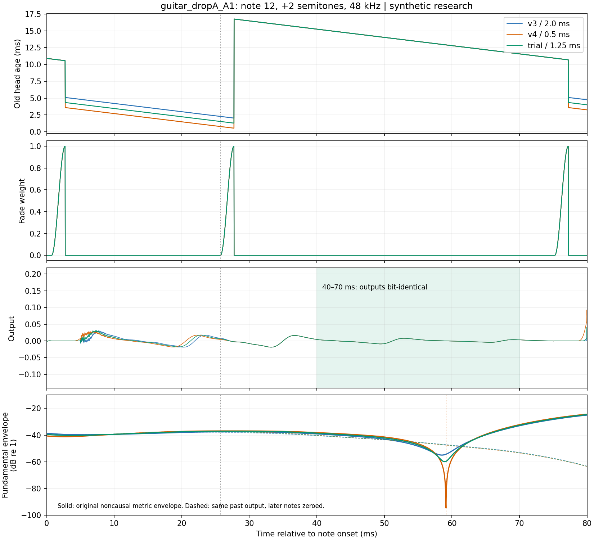
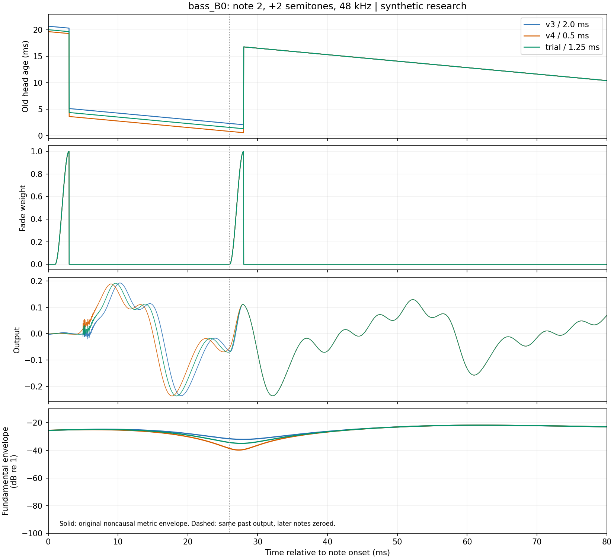

# Transpose v4 포락선 골 원인 분석과 수정안 검증

2026-10-25 KST · **합성 입력 연구 / 제품 통합·음질·실시간 승인 없음**

**판정:** 기타 A1 강약교대 +2반음의 12번째 음에서 기록된 추가 골 19.908dB는 그 시점의 실제 출력 감쇠량이 아니다. 실제 출력이 동일한 구간에서도 비인과 대역 필터·Hilbert 포락선이 앞뒤 음의 위상과 진폭을 섞어 서로 다른 골을 만든다. B0에서는 첫 접합에 온전한 한 주기의 후보가 없는 구조적 문제가 남는다. 읽기 하한 1.25ms 절충안은 지연 계약을 지키고 알려진 입력의 골 최댓값을 줄였지만, 새 시드까지 포락선 문제를 해결하지 못했다. **T6 기본 후보는 v3를 유지한다. v4와 이번 절충안은 추가 연구 후보다.**

## 근거와 변경 범위

- 원본: PR [#150](https://github.com/raven-deadwire/SpectralForge-Chimera-Amp-Matrix/pull/150), `be06fab38fef98aa7c51d2ab7a698917de167dc1`. 조회 시 Open/Draft.
- T6 역할 결정: PR [#152](https://github.com/raven-deadwire/SpectralForge-Chimera-Amp-Matrix/pull/152), 병합 `95dbd8b96a5b952c2a96c6ea95ff9bbc43c05408`. v3를 실제 DI·청취·DAW 시험 기본 후보로 지정한 결정이며, 그 시험의 완료를 뜻하지 않는다.
- 새 시드 실행 전 원격 등록: [`7b7f069`](https://github.com/raven-deadwire/SpectralForge-Chimera-Amp-Matrix/commit/7b7f069dd5c7b54355fccda477a037b4766e981e). 코드·바이너리·기준 해시와 후보를 고정했다. 이후 DSP·채점기·기준·후보를 변경하지 않았다.
- JUCE `d6181bde38d858c283c3b7bf699ce6340c050b5d` / 8.0.8, GCC -O2, Linux. 실행 환경과 빌드 명령은 [증거 폴더](evidence/transpose-v4-envelope-20261025/)의 `provenance.json`, `build.json`에 있다.
- `Source/`, 연구 DSP 원본 두 헤더, 기존 채점기, 플러그인·T6 기본값은 변경하지 않았다. 연구 하네스에서 기존 `setUpshiftMinimum()` / `setSpliceFade()` 설정을 시험했다. 후보 이름은 `env-floor125`이며 공식 v4를 덮어쓰지 않는다.
- `Validation/transpose-latency-targets.json` SHA-256은 원본과 같은 `aff449dff7a9ed4715f05f5d55005f57f956fb84db8df68d64fb47b0c1c592ce`다. T1~T4 기준과 13가지 블록 비교 패턴을 유지했다.

## 원자료 재현과 추적 방식

기존 `known_diagnostics.py`를 원본 엔진으로 재실행했다. 원격 `known-diagnostics.json.gz`와 **JSON 전체가 동일**했다. B0 기존 실패 시드 1414의 최대 지연 15.660965638→13.696003191ms, 48kHz 252개 음의 추가 골 최대 14.590399098→19.908263445dB도 그대로 재현했다.

새 `EnvelopeTrace`는 샘플별 두 읽기 위치, 실제 tap 값, 페이드 가중치·길이, 저역/고역 출력, 검출·접합 횟수를 기록한다. CSV I/O는 `process()` 밖에서 수행한다. A1 12번째 음과 B0 2·5·8·10번째 음을 v3/v4/1.25ms 후보로 비교했다. **15개 추적 모두 tap과 가중치로 재구성한 저역 출력 오차 0**, 일반 렌더러와의 출력 오차도 0이다. CPU 측정에는 추적 실행파일을 사용하지 않았다.

아래 읽기 위치는 해당 샘플 출력에 사용된 위치다. 원보고서의 샘플 처리 후 상태값과는 한 번의 읽기 위치 증분만큼 차이가 날 수 있다.

## 기타 A1 강약교대, +2반음, 12번째 음

48kHz, 입력 음 시작 1.225초. 12번째는 약한 음이며 다음 강한 음은 75ms 뒤에 온다.

| 측정 | v3 | v4 | 1.25ms 후보 |
|---|---:|---:|---:|
| 저역 재정렬 시점 | +0.750ms | 동일 | 동일 |
| 재정렬 새 읽기 나이 | 5.348ms | 3.848ms | 4.598ms |
| 첫 일반 접합 시점 | +25.750ms | 동일 | 동일 |
| 접합의 이전 → 새 읽기 나이 | 2.287→17.000ms | 0.787→17.000ms | 1.537→17.000ms |
| 재정렬 / 일반 접합 페이드 | 2 / 2ms | 동일 | 동일 |
| 입력 대비 추가 골 | −13.639dB | +19.908dB | −11.968dB |

첫 접합의 새 읽기 위치가 모두 17ms라서 페이드가 끝나면 궤적이 합쳐진다. **v3와 v4가 마지막으로 다른 샘플은 음 시작 +27.729ms이며, +40~70ms 출력은 비트 동일**하다. 그런데 v4의 분석 포락선 최저점은 **+59.125ms**다. 그 지점에 별도의 접합이나 페이드가 없다.

기존 진단은 기음의 0.7~1.3배 대역에 `sosfiltfilt`를 적용하고, 전체 신호에 Hilbert 변환을 적용한다. 이후 5~60ms 구간에서 현재 값 대비 뒤쪽 최댓값을 찾는다. 양방향 필터와 Hilbert 변환은 해당 음의 과거·미래 문맥을 모두 사용한다. 강약 차이가 큰 다음 음의 기여와 앞선 접합의 위상 변화가 분석상 거의 영점에 가까운 골을 만든다.

**대조 실험:** 다음 음 시작 이후의 출력만 0으로 바꾸고, 그 이전 출력은 비트 동일하게 유지했다. v4의 절대 출력 포락선 골은 **36.518→3.544dB**, v3는 **2.970→1.757dB**로 바뀌었다. +59.125ms 직전 한 주기의 실제 출력 RMS는 세 후보 모두 **0.004900989**였다. 이는 기존 최악값을 그 시점의 실제 음량 손실로 읽을 수 없다는 직접적인 근거다. 새 합격 기준으로 바꾸거나 원래 진단 값을 삭제하지 않았다.

첫 2ms 일반 접합에서의 파형 간섭량도 단순한 대규모 페이드 상쇄와 맞지 않는다. 두 가중 tap의 개별 제곱합 대비 혼합 출력 제곱합은 v3 +0.229dB, v4 +0.379dB다. 이 값은 청감 점수가 아니라 해당 짧은 페이드 내부의 상쇄 여부를 분리하기 위한 진단이다.



## B0 긴 음: 지연 개선과 제한된 접합 후보

시드 1414, 48kHz, +2반음, 2번째 음은 다음과 같다.

| 측정 | v3 | v4 | 1.25ms 후보 |
|---|---:|---:|---:|
| 저역 재정렬 / 첫 접합 | +1.000 / +26.000ms | 동일 | 동일 |
| 재정렬 새 읽기 나이 | 5.348ms | 3.848ms | 4.598ms |
| 첫 접합 이전 → 새 읽기 나이 | 2.287→17.000ms | 0.787→17.000ms | 1.537→17.000ms |
| 읽기 점프의 기음 위상 환산 | 163.501° | 180.169° | 171.835° |
| 입력 대비 추가 골 | 8.472dB | 16.163dB | 11.348dB |
| 출력 포락선 골 위치 | +27.917ms | +27.292ms | 원자료 참조 |

0.5ms 하한은 검출을 앞당기지 않는다. 재생 위치를 현재 쪽으로 이동시킨다. 재정렬 뒤 25ms 유지와 8ms 어택 재반복 방지 조건은 그대로이므로 첫 접합에서 과거로 돌아갈 수 있는 상한은 이 사례에서 17ms다. B0 한 주기는 약 32.4ms여서 온전한 한 주기 접합 후보가 존재하지 않는다. v4의 읽기 간격은 여기서 거의 반주기가 된다. 이것은 제한된 후보 구간과 과거 12ms 유사도 검색의 한계다.

다만 **반주기 점프 = 페이드 자체가 16dB를 지웠다는 뜻은 아니다.** 실제 2ms 페이드 간섭량은 v3 −1.228dB, v4 −0.251dB다. 대역 제한된 포락선은 위상 전환 전후를 더 길게 합쳐 골을 만든다. 이 사례는 접합 부근의 기음 위상 연속성 위험을 보여 주지만, 수치를 곧바로 광대역 음량 손실이나 청감 회귀량으로 바꿀 수 없다. 5·8·10번째 음의 읽기 위치와 골도 보존했으며 모든 음이 같은 방향으로 변하지 않는다.



## 수정안 탐색과 고정 후보

기존 시드의 세 악기 × 세 입력 × 세 표본률 × +1/+2반음에서 사전에 정한 6가지 변형을 시험했다. 아래 골 통계는 원보고서와 같은 **48kHz 252개 음**이며 청감·합격 지표가 아니다.

| 설정 | 추가 골 p90 / 최대, dB | B0 기존 긴 음 최대, ms |
|---|---:|---:|
| v3: 하한 2ms | 4.718 / 14.590 | 15.661 |
| v4: 하한 0.5ms | 4.861 / 19.908 | 13.696 |
| 하한 0.75ms | 4.831 / 15.941 | 14.089 |
| 하한 1.0ms | 4.845 / 14.032 | 14.469 |
| **하한 1.25ms** | **4.841 / 13.745** | **14.809** |
| 하한 1.5ms | 4.754 / 14.652 | 15.123 |
| 하한 0.5ms + 일반 페이드 4ms | 4.127 / 18.863 | 13.789 |
| 하한 0.5ms + 일반 페이드 8ms | 3.263 / 44.154 | 14.396 |

1.25ms를 제한적인 절충 후보로 선택하고 원격 등록했다. 페이드 연장은 p90 개선만 보면 좋아 보이지만 최악 사례를 악화시켜 채택하지 않았다. 1.25ms 역시 v3보다 p90가 약간 높고 v4의 지연 이득을 일부 반납한다. 입력 주파수·음 번호·정답 onset을 DSP에 전달하지 않았다. 검출·25ms 유지·8ms guard·2ms 페이드·128샘플 접합 보류는 그대로다.

## 원래 기준과 새 시드 검증

이번 작업에서 처음 사용한 holdout **524287 / 786433 / 999983**, 긴 음 **524309 / 786457 / 1000003**을 고정했다. 44.1/48/96kHz × −2/−1/+1/+2반음 × block 128. 각 후보 792회 중 새로운 입력은 432회이며 나머지 360회는 기존 대조군이다. 아래 표는 기존 대조군을 포함한 792회 전체의 결과다. 새 입력만의 별도 판정에는 기존 정상음 대조군을 명시적으로 추가했다. 그 별도 판정에서도 결론은 같으며 v4의 짧은 음 최대만 9.647ms로 더 작다.

| 기준 | v3 | v4 | 1.25ms 후보 | 기존 기준 |
|---|---:|---:|---:|---|
| T1 고역 어택 최대 | 5.625ms | 5.625ms | 5.615ms | ≤10ms, 모두 PASS |
| T2 짧은 / 긴 음 최대 | 6.351 / 9.459ms | 동일 | 동일 | ≤10ms, 모두 PASS |
| T3 짧은 음 | 10.568ms | 9.705ms | 10.112ms | ≤12ms |
| T3 B0 긴 음 | **15.600ms, 초과** | 13.748ms | **14.464ms** | ≤15.5ms |
| T3 A0 긴 음 | 18.184ms | 15.340ms | 17.170ms | ≤19ms |
| T3 A1 긴 음 | 10.129ms | 8.467ms | 9.281ms | ≤11ms |
| T4 워블 / 음정 오차 | 0.593 / 0.001 cents | 동일 | 동일 | 각 ≤1 cent |
| T4 오검출 / 누락 / 저역 오재설정 | 0 / 0 / 0 | 동일 | 동일 | 모두 0, PASS |

1.25ms의 T3 판정은 `REPORT_WITHIN_CEILING`이며 업시프트 전체 10ms 이하라는 뜻이 아니다. #150의 공개된 새 시드 세트도 후보로 792회 재시험해 T1/T2/T4 PASS, T3 B0 **14.798ms**를 확인했다. 기존 시드 1414에서는 **14.809ms**다.

- 새 432조합 × 기존 13패턴: **5,616/5,616 비트 동일**, NaN/Inf·부호가 다른 0도 검사.
- 새 행렬의 다운시프트: v3↔v4 및 v3↔1.25ms 각각 **396/396 출력 해시 동일**.
- 원본 렌더러↔추적/변형 설정을 추가한 최종 일반 렌더러: v3/v4 **216/216 출력·이벤트 동일**.
- 네이티브 **378그룹 PASS**: 후보 54그룹 포함, mono/stereo, 세 표본률, ±12까지 9개 반음, 블록·바이패스·0반음·무음·스테레오·reset·자동화·process 내 C++ 할당 0.
- 같은 378그룹 ASan/UBSan PASS. LeakSanitizer는 실행 환경의 ptrace/proc 제약으로 실패하여 `detect_leaks=0`으로 재실행했다. 누수 검증 통과나 JUCE 전체 sanitizer 빌드로 주장하지 않는다. 초기 실패 로그도 보존했다.
- 기존 PitchRegressionTests / StabilityTests / GateTests PASS. 실행 중 함께 나온 타이밍은 CPU 수용 증거로 사용하지 않았다.
- 초기 공유 파일명 parity 하네스에서 출력 길이가 다른 파일을 비교하는 실패가 발생했다. 원인은 확정하지 않았으며 성공으로 세지 않았다. 입력별·엔진별 독립 파일명과 길이 확인을 갖춘 전체 216회 재시험으로 교체했고 초기 파일 해시·길이 기록도 보존했다.

### 새 포락선 진단은 해결을 입증하지 못했다

새 pluck/긴 음 전부를 같은 기존 진단으로 추가 분석했다. 원래 252개 음과 다른 집합이므로 두 표의 최댓값을 직접 회귀량으로 비교하면 안 된다.

| 새 합성 진단 | v3 | v4 | 1.25ms 후보 |
|---|---:|---:|---:|
| 48kHz 756개 음 p90 / 최대 | 4.554 / 47.801dB | 4.287 / 45.293dB | 4.341 / 31.281dB |
| 세 표본률 2,268개 음 p90 / 최대 | 4.483 / 47.801dB | 4.344 / 45.293dB | **4.388 / 45.071dB** |

후보의 새 최악은 **96kHz B0, 긴 음 시드 524309, +1반음, 3번째 음, +26.469ms**다. v3/v4 새 최악도 B0 접합 부근에서 발생한다. 알려진 A1 최악값을 낮췄다는 이유로 B0 전반이 해결됐다고 할 수 없다. 모든 새 큰 골을 A1과 같은 원인으로 확정한 것도 아니다. 비인과 지표의 문맥 민감도와 제한된 저역 접합 후보 문제를 함께 남긴다. 이 결과를 본 뒤 파라미터를 다시 맞추지 않았다.

## CPU 재현성과 DSP 비용

빌드·기능 검사를 끝낸 뒤 별도 순차 실행했다. 공유 Linux VM의 허용 논리 CPU 하나에 affinity를 고정했다. 이는 전용 하드웨어·실시간 우선순위·실제 드라이버 콜백과 다르다. B0/A0 긴 음 시드 104729, ±2반음, 세 표본률 × 64/128/256샘플. 일반 조건 3회, **96kHz/64는 15회**씩 엔진 순서를 교차했다. 각 엔진 **156렌더 / 414,588콜백**, 총 1,243,764콜백이다. 마지막 짧은 블록의 실제 샘플 수로 마감을 계산했다.

| 측정 | v3 | v4 | 1.25ms 후보 |
|---|---:|---:|---:|
| 96kHz/64 평균 thread CPU의 렌더별 중앙값 | 6.537µs | 6.429µs | 6.460µs |
| 같은 조건 p99의 렌더별 중앙값 | 25.755µs | 23.793µs | 23.855µs |
| 같은 조건 최악 thread CPU | 3,476.870µs | 5,165.140µs | 2,449.300µs |
| 같은 조건 thread / wall 마감 초과 | **6 / 6** | **5 / 5** | **5 / 5** |
| 전체 조건 thread / wall 마감 초과 | **8 / 8** | **5 / 5** | **8 / 8** |

96kHz/64의 마감은 666.667µs다. 이전 #150의 1→2회와 이번 6→5회의 순서는 다르다. 시험 반복 수·환경이 다르므로 이전 절대 횟수와 직접 성능 비교하지 않는다. **초과 자체는 재현됐고, v4의 일관된 비용 악화는 재현되지 않았다.**

- 모든 마감 초과 콜백에서 body/high 접합 검색 횟수는 0이었다. 접합 검색 급증으로 이 초과를 설명할 수 없다.
- 96kHz/64에서 초과한 각 동일 콜백 위치는 해당 엔진의 15회 중 1회만 초과했다. 그 위치의 중앙값은 약 **4.587~9.234µs**였다. v3의 한 초과는 첫 음 이전 +79.3ms 무음 구간에서 발생했다.
- 다운시프트 78개 조건·반복 그룹에서 세 엔진 출력 해시가 모두 같았고 여기에도 초과가 있었다. v4 초과 5회는 모두 −2반음 경로였다.
- 조건별 body/high 접합 총횟수는 세 엔진이 같았다. 후보는 추가 필터·예측기·할당을 넣지 않고 기존 준비 단계 상수만 바꾼다. 일반 DSP 비용은 비슷한 범위지만 검색 구간과 위상에 따라 세부 비용은 달라질 수 있다.
- wall만 긴 사례로 설명되지 않고 thread CPU도 함께 길어졌다. 공유 VM 변동이 일관된 알고리즘 비용 증가보다 유력하다는 **추론**은 가능하지만 원인을 확정하지 않는다. 초과를 제거하거나 평균으로 덮어 T5 PASS로 처리하지 않는다.

모든 callback CSV와 마감 초과 위치를 `cpu-callbacks.tar.gz`, `cpu.json.gz`, `cpu-repeat-detail.json`에 보관했다. 전체 9개 조건의 평균·p99·최악·초과·접합 횟수는 `cpu-summary.json`에 있다.

## 최종 상태와 다음 판단

| 후보 | 합성/검증 상태 | 역할 |
|---|---|---|
| **v3** | 블록 불변. T1/T2/T4 통과. B0 T3 초과 재현. T5 마감 초과 존재 | **현재 지정된 T6 시험 기본 후보 유지**. T6 완료·최종 승인 상태는 아님 |
| **v4 0.5ms** | B0 지연 개선과 T3 상한 준수. 알려진 A1 최악 진단값의 분석상 원인 확인. B0 접합 위상·새 골·T5 위험 잔존 | 연구 후보 유지. 제품 DSP·T6 기본값으로 승격하지 않음 |
| **1.25ms 절충안** | 지연 개선 일부 유지, 기존·새 시드 T1/T2/T4 및 T3 상한 준수, 5,616 블록 비교 통과. 알려진 골 개선이 새 입력 전체의 해결로 일반화되지 않음 | **추가 연구 후보**. 공식 v4 교체·T6 후보 변경·음질 승인 보류 |

후속 연구는 기존 지연 기준을 유지하면서, 검출 후 확보된 저역 이력 안에서 접합의 위상·어택 재반복을 함께 제어하는 쪽이 필요하다. 단순 하한 조정이나 페이드 연장만으로는 B0의 부족한 주기 이력을 해결하지 못했다. 비인과 포락선 진단은 유지하되, 접합별 직접 파형·인과적 에너지 대조를 함께 보고해야 한다. 이를 새 합격 기준으로 도입하려면 별도로 정의하고 검증해야 한다.

**실제 악기 DI·청취자 자료를 사용하지 않았고 Windows/macOS DAW·고정 PDC·제품 통합은 실행하지 않았다.** #150의 과거 헤드리스 VST3 결과를 이번 1.25ms 후보에 승계하지 않는다. 제품 코드 교체, PR 병합, 릴리스, 최종 음질 승인을 하지 않는다.

## 재현

등록 커밋을 checkout하고 고정 JUCE 8.0.8을 준비한다. 기존 보고서의 바이너리 해시는 경로·컴파일러에 따라 달라질 수 있으므로 자신의 새 출력 폴더에 등록한다. 공개된 아래 시드는 더 이상 blind holdout이 아니다.

```sh
python3 Tools/TransposeNext/build.py --juce /path/to/JUCE --out build/original
python3 Tools/TransposeNext/build_envelope.py --original-build build/original --out build/envelope
python3 docs/evidence/transpose-v4-low-upshift-20261025/known_diagnostics.py build/original/TransposeProbe build/known.json
python3 Tools/TransposeNext/envelope_study.py --bin build/envelope --out build/exploration --trace
python3 Tools/TransposeNext/envelope_validation.py freeze --bin build/envelope --out build/validation
python3 Tools/TransposeNext/envelope_validation.py targets --bin build/envelope --out build/validation
python3 Tools/TransposeNext/envelope_validation.py blocks --bin build/envelope --out build/validation
# 모든 빌드/기능 시험 종료 후 단독 실행
python3 Tools/TransposeNext/envelope_validation.py cpu --bin build/envelope --out build/validation
python3 docs/evidence/transpose-v4-envelope-20261025/analyze_traces.py build/exploration
```

원자료·실패·소스/실행파일 식별·그림은 [증거 폴더](evidence/transpose-v4-envelope-20261025/)에 있고 `SHA256.json`으로 무결성을 확인할 수 있다. 일반 렌더 출력 파일은 재현 도구로 다시 만들며, 저장된 샘플 추적은 표시 구간을 잘라 보관했다. 전체 입력·출력 SHA와 이벤트/점수 행은 압축 JSON에 보존했다.
