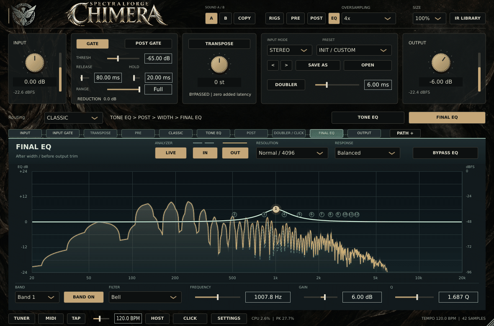
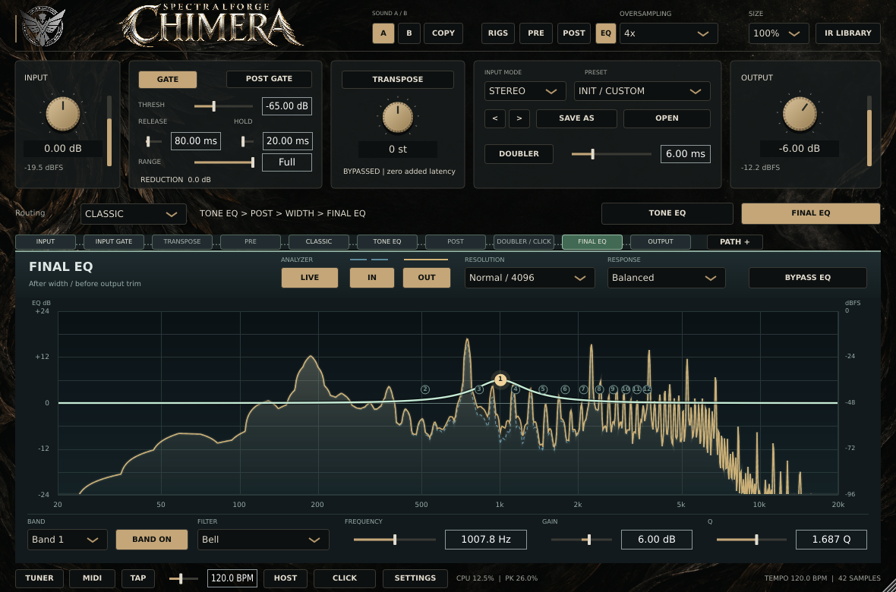

# EQ prototype: measured implementation evidence

Measured on October 12, 2026. This is the first implementation stage of
[PR #50](https://github.com/raven-deadwire/SpectralForge-Chimera-Amp-Matrix/pull/50).
The [implementation notes](../../EQ_ANALYZER_PROTOTYPE.md) define P0 and remaining work.

**Result:** the focused native EQ workspace, real variable-size analyzer and
compatibility checks passed on the local Linux Release build. This establishes
a development prototype; it is not complete October 23/30 acceptance or a
public-beta release.

## Native motion proof

These are 32 actual JUCE editor captures from a native X11 peer and message
loop, driven by a separate paced audio thread calling the production
processBlock. The input is a generated harmonic pluck: 62.5, 187.5, then 750 Hz;
48 kHz, 128-sample stereo blocks, amplitude 0.1, equal channel polarity,
0.65-second retrigger and 0.18-second exponential decay. This is synthetic
test audio, not an instrument DI or physical audio device.

The normal input/output meters and the real Final EQ IN/OUT spectra respond.
The analyzer consumes actual tap samples and performs FFTs; the test never
injects finished spectra. The 32 images are distinct and passed complete PNG
decoding. The GIF duration is 1.87 seconds, using measured
capture intervals rounded to GIF centiseconds, with a median interval for
the last frame. It is not forced to 25 fps and contains no invented intermediate
frames. See [capture timestamps and meter readings](eq-analyzer-live-frames.csv),
[PNG verification and hashes](eq-png-verification.json), and
[animation provenance](eq-motion-provenance.json).

Calibration is tested separately with opposite-polarity stereo sines fed
through the production EQ processing. At 1007.8125 Hz, both banks and all
three FFT sizes measured IN -20 dBFS and the actual +6 dB EQ OUT -14 dBFS,
within the original native tolerances of 0.10 and 0.15 dB. Core calibration
uses 0.02 dB tolerance, including mono-channel power, DC and Nyquist.

## Passed checks and provenance

| Suite | Result | Duration | Raw execution record |
|---|---|---:|---|
| ChimeraGateProcessorTests | PASS | 11.25 s | [eq-first-run.log](eq-first-run.log) |
| ChimeraGraphicalEQTests | PASS | 26.56 s | [eq-first-run.log](eq-first-run.log) |
| ChimeraEQAnalyzerTests | PASS | 2.99 s | [eq-png-diagnostic.log](eq-png-diagnostic.log) |
| ChimeraGraphicalEQUITests | PASS | 56.43 s | [eq-native-final.log](eq-native-final.log) |

These are real passes across targeted runs. Original JUnit files retain their
actual statuses; there is no synthesized all-pass single-run XML.
[The manifest](eq-validation-manifest.json) maps each pass to its log/XML and
records exact source SHA256 hashes. An earlier native diagnostic caught PNG
encoding starving the message thread and clearing a discontinuous spectrum;
the corrected fixture waits for a new complete observation and encodes the
motion sequence after stopping audio. Output PNGs now use complete in-memory
encoding, replacement and byte-for-byte read-back validation. All 49 final
PNG artifacts passed full decoding. These changes affect the test writer.

Coverage includes:

- The released 122 EQ parameters, 24 band automation, seven filter choices,
  numeric entry, drag/wheel host gestures, project state, A/B, legacy migration
  and 48 factory defaults.
- Existing EQ/Gate DSP contracts, four tested EQ sample rates, mono/stereo,
  exact bypass, actual project/A-B audio recall and route placement.
- Real FFT windows; calibrated antiphase stereo; 31/55 Hz and stepped off-bin
  input within honest bin tolerance; noise; finite-input recovery; power-domain
  smoothing; source stop/resume; bounded FIFO overflow recovery.
- Exactly one visible bank, no hidden-bank capture/FFT, retained selection
  through navigation and mode changes, independent IN/OUT layers and LIVE.
- Native layout and graph interaction at 75%, 100%, 125% and 150%.
- Packaging checks: 8 passed and 3 Windows-only checks skipped locally.
  Release-scope policy check passed.

### Measurement environment

Ubuntu 24.04 x86_64; GCC 13.3.0; CMake 4.4.4; Release configuration;
JUCE 8.0.8 at d6181bde38d858c283c3b7bf699ce6340c050b5d.
AMD EPYC 9V74 host, 9 visible vCPUs, 8-core quota and 8 GiB memory limit.
The native peer ran on authenticated local TCP Xvfb (1920×1200×24) with Openbox.
This is a shared virtual environment, not a dedicated hardware benchmark.

Measurements were taken from the uncommitted prototype tree based on
3817246f779a50f19b5378ec9661a2275e6b91b2. Its generated preview identity therefore contains the baseline
revision; exact changed-source hashes identify the code actually measured.
The GitHub workflow builds the submitted commit with that commit's own
preview identity. [Build metadata](chimera-build-version.json) is retained
without relabeling the locally tested binary.

## FFT cost at 48 kHz

Each observation performs **four** frequency transforms: L/R at IN and OUT.
Each row contains 160 measured updates after 20 warm-up iterations.

| FFT | Bin spacing, Hz | Window, ms | Four FFTs p50 / p99, µs | Complete update p50 / p99, µs | Derived one-core equivalent at 25 Hz |
|---:|---:|---:|---:|---:|---:|
| 2048 | 23.4375 | 42.67 | 116.89 / 174.75 | 134.21 / 192.31 | 0.348% |
| 4096 | 11.7188 | 85.33 | 205.07 / 317.66 | 233.95 / 348.65 | 0.612% |
| 8192 | 5.8594 | 170.67 | 529.41 / 669.88 | 581.78 / 724.26 | 1.495% |

[All raw FFT measurements](eq-analyzer-cpu.csv) also include 96 and 192 kHz.
The 8192-point choice has four times finer bin spacing than 2048 at the same
sample rate, with four times the observation window. Hann noise bandwidth is
1.5 bins. Neither screen interpolation nor bin spacing alone promises to
separate arbitrarily close tones.

FFT timing is elapsed wall time for the four JUCE frequency-only transforms,
including their magnitude conversion. Complete update adds FIFO consumption,
window assembly, normalization and temporal smoothing. It excludes spectrum
path construction and painting. The final column is mean update time ×25/s,
expressed as a percentage of one core; it is a derived estimate, not measured
whole-process CPU utilization or a guaranteed maximum.

## Native response and rendering

Each bank/resolution case observes 100 FFT updates while native message
dispatch and synthetic audio run concurrently. A panel snapshot is made at
each observation to measure composition separately.

| Bank | FFT | First complete data observed, ms | First forced component render complete, ms | Path p50, ms | Panel paint p50, ms | Observed FFT-progress interval p50 / p99, ms |
|---|---:|---:|---:|---:|---:|---:|
| Tone | 2048 | 59.85 | 62.36 | 0.150 | 2.156 | 42.42 / 51.34 |
| Tone | 4096 | 112.47 | 123.17 | 0.148 | 2.112 | 42.67 / 50.44 |
| Tone | 8192 | 183.70 | 186.06 | 0.150 | 2.148 | 42.62 / 51.55 |
| Final | 2048 | 59.74 | 63.28 | 0.146 | 2.122 | 42.45 / 49.83 |
| Final | 4096 | 101.23 | 103.59 | 0.148 | 2.241 | 42.66 / 50.90 |
| Final | 8192 | 225.99 | 228.62 | 0.150 | 2.224 | 42.59 / 50.31 |

[Raw native measurements](eq-analyzer-native-ui.csv) also retain p99 costs,
complete snapshot timings and measured process CPU with snapshots.
Readiness and frame progress are observed by 20 ms message-loop polling;
they are not display scanout latency or precise presented FPS. The analyzer
timer remains nominally 25 Hz. A larger FFT requires a longer first real
observation and spreads transients over more sample time.

Panel paint timing covers that component's own drawing during a snapshot,
excluding child controls. Snapshot timing includes panel composition and
image allocation. The process-CPU field explicitly includes synthetic DSP,
native UI work and forced snapshots. It must not be quoted as isolated analyzer
CPU, ordinary UI CPU, or a before/after optimization against the old product.

## Audio callback cost and additional latency

The EQ-only fixture processes both banks with all 24 bands active, captures
one bank, and keeps the analyzer consumer outside the timed audio callback.
Across 24 configurations and 14,400 measured callbacks (48/96 kHz,
64/128/512 samples, capture off or one of three FFT sizes), every row recorded
zero callback-budget overruns and zero instrumented callback allocations.
See [EQ-pair callback measurements](eq-analyzer-callback.csv).

The native fixture below calls the entire existing processBlock route in
Classic mode at 48 kHz, 128 samples, stereo, with native dispatch/painting
active and no forced snapshots during these phases. Callback budget is
2666.67 µs.

| Capture / FFT | Measured callbacks | p50, µs | p99, µs | Maximum, µs | Budget overruns |
|---|---:|---:|---:|---:|---:|
| Off | 575 | 354.70 | 662.45 | 1416.46 | 0 |
| 2048 | 577 | 356.47 | 604.77 | 898.59 | 0 |
| 4096 | 577 | 363.54 | 579.60 | 1920.20 | 0 |
| 8192 | 577 | 377.38 | 660.78 | 1450.24 | 0 |

[Whole-processor callback CSV](eq-analyzer-full-callback.csv).
These are observed elapsed callback costs on an ordinary paced test thread;
they do not certify real-device xruns or DAW scheduling. Small differences
between ordered runs are not a controlled causal overhead estimate.

**Additional host-reported latency: 0 samples.** The processor reported its
existing 42 samples in every compared configuration. At 48 kHz this existing
latency is 0.875 ms; it has not become a zero-latency plugin. Whole-processor
comparisons checked finite samples and literal memory equality for both
channels with active Tone/Final EQ, capture toggles, a resolution switch,
impulses and deliberately full FIFOs. Every sample remained bit-identical;
maximum numerical error was zero.

[The source audit](eq-sound-state-audit.json) also confirms that PluginProcessor,
ChimeraDSP, parameter definitions and the GraphicalEQ processing class are
byte-identical to the baseline. Only consumer-side FIFO methods were added;
the original producer and 8192-frame capacity remain unchanged. FFT and
display work occur on the message thread and never insert an audio buffer,
lookahead or callback wait.

### High-rate observation

At nominal 192 kHz / 128 samples / FFT 8192, the native probe observed
2600.4 ms, 3,891 callbacks and
498,048 produced samples: an effective
191,527 samples/s
(99.75% of nominal), with
0 FIFO sample drops. See [the high-rate CSV](eq-analyzer-high-rate.csv).

This is one short near-nominal observation, not a sustained-rate guarantee.
At 192 kHz the unchanged FIFO spans 42.67 ms against a nominal 40 ms UI period;
long UI stalls can still overflow it. Overflow clears analysis history and
requires a fresh complete window while audio processing continues. Longer
high-rate host sessions remain part of candidate acceptance.

## Remaining acceptance

The local result is Linux native validation with synthetic audio. Windows
and macOS checks are configured in the dedicated workflow and must be assessed
from their actual run status. Physical audio-interface/DAW sessions, actual
guitar/bass DI, listening acceptance and the October 23 installer are not
claimed here. Freeze, persistent-slot add/delete, Undo/Redo and the later
editing features remain outside this P0 prototype.

The selected workflow uses the opt-in EQ Preview identity and produces a
separate Windows Standalone artifact only after its four tests pass. No public
beta tag, release asset, feed, installer or website is changed by this work.
