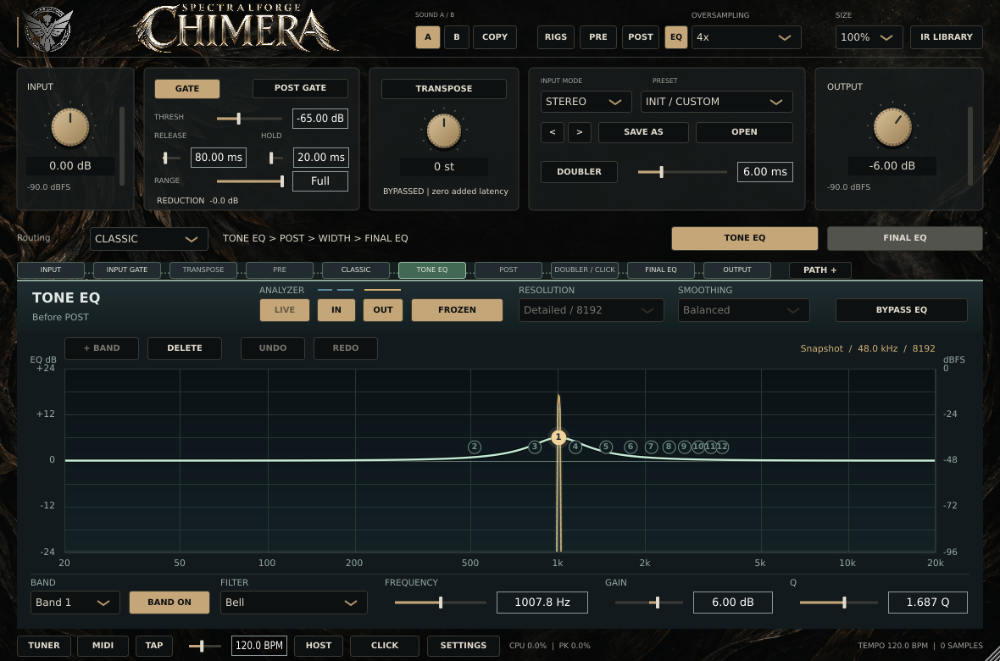
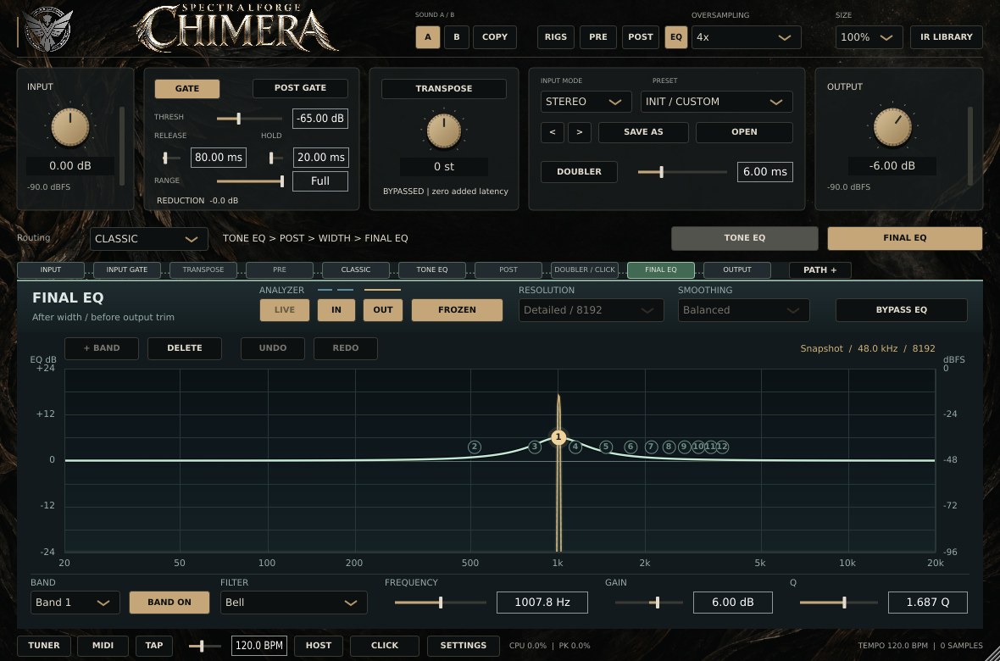

# October 23 EQ editing — exact-source execution record

## 판정과 소스

**Linux 개발 환경: EQ 관련 8개 CTest 실행 및 통과. 실제 설치본·DAW·오디오 인터페이스 성능 수용: NOT_ASSESSED.**

- 비교 기준: [PR #52 / a2ae89467665b9122b7d1ae744dc52fb8f693bd6](https://github.com/raven-deadwire/SpectralForge-Chimera-Amp-Matrix/tree/a2ae89467665b9122b7d1ae744dc52fb8f693bd6). 실행 종료 뒤 다시 조회했으며 기준 head는 그대로였다. 요구사항은 [Issue #53](https://github.com/raven-deadwire/SpectralForge-Chimera-Amp-Matrix/issues/53)의 10월 23일 최소 기능이다.
- 실제 빌드·실행 소스: **e52976f869ea872e3094f3a945d74496665285c5**, tree **a01663311350c763c01d6122bdb9b5df1247687d**. provenance 수집 시 tracked 변경은 없었다.
- 빌드 식별자: **1.3.1-preview.e52976f869**. Release, GCC 13.3.0, CMake 4.4.4, Ninja 1.13.2, JUCE 8.0.8. 기존 JUCE 패치의 실제 SHA-256도 [toolchain 기록](local-toolchain.json)에 포함한다. EQ preview와 UI probes는 ON이다.
- 실행 날짜는 **2026-10-12 UTC**다. CTest 내부 로그는 로컬 KST로 10월 13일 02:07부터 표기한다.
- 이 후속 증거 커밋은 문서·실행 기록·원시 자료·캡처와 해당 증거 경로의 EOL 보존 속성만 추가한다. 새로운 소스 실행으로 재분류하지 않는다. C++·테스트·CMake·워크플로 코드는 실행한 e52976f와 동일하다.
- 전체 설계, 마이그레이션, 실제 DAW 수용 조건: [EQ_EDITING_OCT23.md](../../EQ_EDITING_OCT23.md).

[실행 요약·바이너리 SHA-256](execution-summary.json), [소스 SHA-256·보존 검사](eq-attribution-provenance.json), [전체 CTest 로그](LastTest.log), [JUnit](eq-results.xml), [콘솔](ctest-console.log), [빌드 식별자](chimera-build-version.json)를 함께 보관한다. JUnit의 긴 system-out은 잘릴 수 있으므로 상세 판정에는 전체 LastTest.log를 사용한다. 등록된 50개 테스트 중 아래 8개를 선택한 실행이며, 50개 전체 실행으로 주장하지 않는다.

## 실제 실행 결과

| CTest | 시간 | 결과와 범위 |
| --- | ---: | --- |
| ChimeraGateProcessorTests | 11.9559 s | PASS — 기존 Gate/processor 계약 |
| ChimeraGraphicalEQTests | 28.5499 s | PASS — 기존 EQ 필터·파라미터·라우팅·상태/A-B·오디오 회귀 |
| ChimeraGraphicalEQUITests | 121.4660 s | PASS — 실제 native peer, 편집 입력, 숫자/drag Undo, Freeze, 복원 경쟁, editor 재생성 |
| ChimeraEQAnalyzerTests | 17.8897 s | PASS — 고샘플레이트 어택·분할 불변·FIFO 회복·오디오 동일성 |
| ChimeraGraphicalEQEditingTests | 27.5925 s | PASS — 점유/슬롯/이력/host ownership/마이그레이션 |
| ChimeraEQSnapshotFreezeTests | 2.68868 s | PASS — 정상 프레임 보존·엄격한 thaw 경계·오디오/할당 불변 |
| ChimeraEQAnalyzerPerformanceTests | 20.6022 s | PASS — 수치·창/샘플 계산 게이트, 관측 비용 CSV 기록 |
| ChimeraEQHighRateAttributionTests | 148.5620 s | PASS — 22 direct + 68 native, 총 90개 원인 분리 조건 |

**8/8 실행, 실패 0, skipped 0, disabled 0. 총 379.31 s.** 세부 JUnit 시간의 합은 379.30688 s다. 일곱 실행 파일이 여덟 CTest를 수행하며, attribution은 native UI 실행 파일의 별도 인자를 사용한다.

### 확인한 편집·호환성 계약

- 전체 **4,967개** 호스트 파라미터의 고유 ID, EQ **122개**의 ID/순서/이름/version hint 10/기본값/범위/정규화/선택 항목을 검사했다. EQ ordinal 4845–4966과 7개 필터 선택을 유지한다.
- Tone/Final 각각 12개 슬롯에서 점유+활성, 점유+비활성, 삭제, 가장 낮은 빈 슬롯 재사용, 13번째 거부, 전체 EQ bypass 보존을 검사했다.
- 80회 값 갱신을 포함한 drag는 하나의 작업이며 host gesture가 균형을 이룬다. 숫자/생성/삭제/Undo/Redo/no-op, 80개 편집 뒤 최대 64개 이력도 검사했다.
- 다른 스레드, 동기 재진입, 동일 값 통지, 고주파수 한 단계 host override, 다른 bank 변경에 의한 지역 이력 중단을 검사했다.
- binary project round trip, 독립된 전역 A/B 점유, 메타데이터 없는 레거시/EQ 도입 전 상태, **8종 손상 메타데이터**, 활성 슬롯 숨김 보정, **48개 공장 프리셋**의 점유/이력 초기화를 검사했다.
- native UI 로그는 두 bank의 그래프 추가/삭제와 숫자/drag 이력, 미확정 숫자 입력이 선택/동일 값 복원 이후 적용되지 않는 회귀를 포함한다.
- native 로그는 pending thaw 상태의 **editor close/recreate**, 늦게 게시된 이전 분석창 거부, **실제 processBlock acknowledgement** 이후 재개를 명시적으로 기록한다.
- [unchanged-contracts.json](unchanged-contracts.json)의 6개 파일은 PR #52 기준과 byte-identical이다. GraphicalEQ.h의 파라미터 정의·EQ DSP, ChimeraDSP.h, 버전/채널/공개 배포 정책 파일이 포함된다. PluginProcessor에는 메타데이터 및 분석용 atomic callback handoff가 추가됐으므로 전체 processor 소스가 동일하다고 주장하지 않는다.

### Freeze 검증의 범위

44.1/48/96/192 kHz × FFT 2048/4096/8192의 **12개 구성**을 실행했다. 모든 raw/smoothed IN/OUT bin과 스트림당 181개 logarithmic displayDB 샘플이 동일하게 보존됐다. 181개 값은 화면 좌표에서의 표시 dB 샘플이며 스크린샷 픽셀 자체의 bit identity를 의미하지 않는다.

빈 상태·부분 창·idle decay·NaN/Inf·유한 입력의 FFT overflow·reset/overflow/샘플레이트 변경에서 마지막 정상 원본과 메타데이터를 검사했다. freeze 해제 후 old in-flight callback이 늦게 완전한 창을 게시하는 조건을 스레드/조건변수로 재현했고, 과거 token으로 새 요청을 확인할 수 없음, 다음 disabled callback 종료 뒤 최종 purge, N개 새 유효 샘플 이후 게시를 검사했다. 정지/재개와 합쳐진 요청도 포함한다.

Freeze 집중 테스트의 bit identity는 두 실제 GraphicalEQ bank의 process를 비교한 것이다. 테스트 구성의 준비된 host latency **42 samples**, APVTS 상태, 계수된 C++ allocation **0**을 유지했다. 전체 processor 경로의 상태·오디오 불변성은 별도의 기존 EQ/analyzer/native suite가 담당한다. 생성/fixture 준비, DAW scheduling, 모든 amp/cab 경로의 할당 인증으로 확대하지 않는다.

레거시 상태는 합성 schema fixture다. 실제 이전 릴리스 바이너리로 저장한 DAW 세션·.chimera 파일 및 구버전으로 되돌려 저장하는 왕복은 별도 수용 항목이다.

## 고샘플레이트·비용: 통과 게이트와 관측값

이 테스트의 수치·창/샘플 계산은 합격 게이트다. 비용과 scheduling telemetry에는 CPU 회귀를 차단하는 임계값이 없으므로, CTest PASS를 “CPU 회귀 없음”이나 DAW deadline 수용으로 바꾸지 않는다.

### 수치/paired cost

- [수치 비교](eq-analyzer-performance-parity.csv): **108/108** 통과. raw/envelope/display 각각 최대 **0.0000152587890625 dB**, 한계 **0.002 dB**. 누락과 discontinuity는 0이다.
- [48조건 요약](eq-analyzer-performance-summary.csv), [384회 ABBA/BAAB 원시 시행](eq-analyzer-performance-paired.csv): 보존된 **beb72f** 분석기 대비 업데이트 비용 감소 관측값은 최소/중앙/최대 **3.1103% / 9.4495% / 19.7529%**다. 음수인 조건은 0/48이며 trial 누락은 0이다.
- 비교 기준은 PR #52 최신 head a2ae894가 아니다. 이 결과로 새 Freeze 기능만의 증분 비용을 분리하거나 기존 macOS 예외를 해소했다고 주장하지 않는다.
- [EQ pair timing](eq-cpu.csv)의 24조건은 48/96 kHz, 64/128/512 samples, mono/stereo, capture off/on이다. FFT 소비자와 전체 processor 비용은 포함하지 않는다.

### 별도 native 48 kHz / 128-sample 전체 processor 관측

[원시 요약](eq-analyzer-full-callback.csv). 네 조건 모두 callback coverage 게이트를 통과했으며, 2,720회 전체 / warm-up 이후 2,320회 호출이다. 이 구성의 period budget은 2.66667 ms다.

| 분석 설정 | p99 | 최대 | 예산 초과 관측 |
| --- | ---: | ---: | ---: |
| Off | 1.775180 ms | 4.018540 ms | 2 |
| 2048 | 0.711354 ms | 1.055300 ms | 0 |
| 4096 | 0.766327 ms | 1.976100 ms | 0 |
| 8192 | 0.781270 ms | 3.194590 ms | 1 |

예산 초과 3회는 유지한다. 분석 off에서도 더 큰 tail이 관측됐으므로 순서대로 시행한 이 값들을 분석기만의 인과적 비용 비교로 해석하지 않는다.

### 별도 96/192 kHz × 3 FFT, 10초 native 관측

[6조건 요약](eq-analyzer-high-rate.csv)과 [개별 update](eq-analyzer-high-rate-updates.csv)를 보존했다. 6조건 모두 accounting error 0, discard/drop 0, unobserved update 0이다. 실제 생산은 nominal의 **99.2700%–99.8150%**로 진단용 ±5% 범위에 있었다.

총 8,597,376 produced = 8,574,720 consumed + 22,656 pending이며, 서로 다른 관측을 합한 pending은 누락이 아니다. 가장 긴 개별 분석 update는 **15.7663 ms**, 가장 긴 관측 consumer gap은 **48.9099 ms**다. 이 구간의 process CPU 최대 110.474%는 한 core 기준이며 장비 전체 사용률이 아니다.

### 90조건 원인 분리 행렬

[방법](eq-attribution/eq-attribution-method.txt), [90조건 요약](eq-attribution/eq-attribution-summary.csv), [2,105개 update](eq-attribution/eq-attribution-updates.csv), [154,089개 callback 원시 CSV의 lossless gzip](eq-attribution/eq-attribution-callbacks.csv.gz).

22 direct + 68 native(8 paint-suppressed control, 60 painted), duration scale 1의 전체 행렬을 실행했다. case 1–90, callback/update sequence와 summary 대조가 일치한다. 54개 capture-on 조건은 NO_LOSS, 36개는 의도된 CAPTURE_OFF다. accounting error, reject/discard, unobserved update는 모두 0이다. 캡처 대상 11,014,656 = consumed 10,874,880 + pending 139,776이며, 이 pending도 독립 조건의 합이다.

**성능 판정은 모든 행에서 NOT_ASSESSED다.** 모든 생산률이 진단용 ±5% 범위(최소 96.8565%, 최대 99.9945%)에 있었지만, 원시 자료에는 다음이 남는다.

| 관측 | 값 |
| --- | ---: |
| callback 실행 예산 초과 | **2,906회** |
| 한 period보다 늦은 callback 시작 | **3,094회** |
| 기존 source-clock rebase | **97회** |
| catch-up block | **10,363개**, 최대 연속 240개 |
| 가장 긴 개별 callback | **12.480635 ms** |
| 가장 큰 원래 source-clock lateness | **63.767830 ms** |
| 가장 긴 panel paint | **22.272230 ms** |

192 kHz / 128 samples의 period는 0.666667 ms다. near-nominal aggregate throughput은 catch-up을 포함하므로 실제 realtime scheduling 보장이 아니다. 이 행렬과 위의 별도 48 kHz 4조건은 서로 다른 관측이며 초과 건수를 섞어서 단일 failure rate로 만들지 않는다.

## Native 캡처 검증

**51개 PNG가 완전히 decode됐다.** 19개 UI 캡처와 32개 live 프레임이다. 75/100/125/150%의 다섯 선택 화면(두 bank의 frozen 화면 포함)을 시각적으로 확인했으며, 검사한 화면에서 control clipping이나 글자 겹침은 발견하지 못했다. 전체 51개에 대한 개별 육안 검사로 확대하지 않는다.

[전체 파일의 크기·모드·SHA-256과 보관 여부](native-capture-manifest.json)를 기록하고, 아래 4개 원본을 이 증거에 보관했다. Freeze label의 48.0 kHz / 8192와 비활성화된 LIVE/FFT/smoothing 표시가 일치한다. 물리 디스플레이 DPI, 모니터 전환과 DAW 내 가독성은 미평가다.

| Tone Snapshot | Final Snapshot |
| --- | --- |
|  |  |

[75%](eq-ui-75.png) · [150%](eq-ui-150.png)

## 재현 환경과 실행 명령

Linux x86_64, glibc 2.39, CPU quota 8 cores, memory limit 8 GiB. 로컬 환경의 UNIX-domain X11 경로 제한 때문에 [기록한 helper](run_eq_native_local.py)로 인증된 local TCP X11 / Xvfb / Openbox를 사용했다. 저장소의 실제 window-manager readiness 검사와 native peer/input assertions는 그대로 사용했다. 임시 X authority cookie는 비공개 파일에 생성하고 종료 시 지웠으며 증거에 포함하지 않는다. helper는 이번 scratch 배치의 정확한 실행 기록이고, 일반 CI 재현은 저장소의 Tools/run_linux_ui_tests.py와 전용 workflow를 따른다.

```sh
cmake -S . -B build-eq -DCMAKE_BUILD_TYPE=Release \
  -DCHIMERA_EQ_DEVELOPMENT_PREVIEW=ON -DCHIMERA_UI_PROBES=ON
cmake --build build-eq --config Release --parallel 3 --target \
  ChimeraGraphicalEQEditingTests ChimeraEQSnapshotFreezeTests \
  ChimeraGraphicalEQTests ChimeraGraphicalEQUITests ChimeraEQAnalyzerTests \
  ChimeraGateProcessorTests ChimeraEQAnalyzerPerformanceTests
python Tools/eq_attribution_provenance.py build-eq
python Tools/run_linux_ui_tests.py -- ctest --test-dir build-eq -C Release \
  -R '^(ChimeraGraphicalEQ.*Tests|ChimeraEQSnapshotFreezeTests|ChimeraEQAnalyzer.*Tests|ChimeraEQHighRateAttributionTests|ChimeraGateProcessorTests)$' \
  --output-on-failure --no-tests=error --output-junit eq-results.xml
```

실제 로컬 빌드는 준비된 JUCE checkout과 toolchain을 사용했다. cache/컴파일러/기존 JUCE patch SHA와 실제 preview 식별자는 보관 자료에서 확인할 수 있다. native wrapper 마지막 행만 위에서 설명한 인증된 TCP helper로 대체했다. xkb/getifaddrs/menu 경고는 기록에 남아 있으며 native peer/readiness 검사나 assertion을 비활성화하지 않았다.

원시 callback CSV는 크기 때문에 gzip으로 보관했다. 압축 해제한 바이트가 원본과 동일함을 확인했으며, 압축본/원본 SHA-256과 원본 크기를 execution-summary.json에 기록했다.

## 최초 검사와 수정 기록

초기 경계 검토에서 thaw의 첫 FIFO flush 이후 이미 실행 중인 콜백이 이전 샘플을 게시할 수 있음을 확인했다. request/ack handoff와 지연된 producer 회귀를 추가했고, 이후 editor 재생성 중 pending request 보존 및 before snapshot 수집 중 host epoch 변경 방어를 반영했다. 이전 빌드는 해당 소스 교정 때문에 중단했으며 중단된 빌드를 PASS로 계산하지 않았다.

중간 링크 검사에서는 생성된 artwork object 2개가 0바이트여서 두 symbol이 누락됐다. [원래 링크 실패](earlier-generated-artwork-link-failure.log)와 [생성 object 재빌드](earlier-generated-artwork-rebuild.log)를 보관한다. 해당 파생 object만 제거하고 다시 생성해 링크했으며 소스나 assertion을 완화하지 않았다. 별도의 중간 compiler 종료에는 완전한 원인 진단이 없으므로 원인을 추정해 기록하지 않는다.

그 뒤의 [집중 실행](focused-console.log)은 editing 26.7135 s / Freeze 2.63088 s, **2/2 PASS**였다. [집중 JUnit](focused-results.xml)과 [전체 집중 로그](focused-LastTest.log)는 당시의 별도 실행으로 보관한다. 이 두 receipt에는 source SHA/바이너리 digest가 없으므로 정확한 e529 전체 실행 증거로 바꾸지 않는다. 위의 8/8 결과는 별도로 완료된 정확한 소스의 재빌드/실행이다.

## 보존 및 실제 수용에서 남은 항목

기존 repaired analyzer reference와 PR #52 transient evidence **84개 파일**은 byte-for-byte 보존됐으며 provenance 검사가 통과했다. 기존 PR #52 high-rate 보고서와 반복 관측 macOS 비용 예외는 수정하거나 종료 처리하지 않았다.

10월 23일 테스트 설치본의 최종 수용에는 실제 패키지 SHA/버전/설치·scan·load, 이전 릴리스 project/.chimera 왕복, 지원 DAW의 Read/Touch/Latch/Write 및 host Undo, 슬롯 삭제/재사용 후 기존 automation lane, A/B·preset·editor 재생성·다중 instance, 실제 DI 청음, 96/192 kHz/실제 buffer의 지속 운용과 UI stall, freeze/thaw·정지/재개·offline rendering, 종료/제거 검증이 남아 있다. 자세한 목록은 설계 문서를 따른다.

전용 3-OS CI의 실행 SHA는 e52976f이며 [run 38280760403](https://github.com/raven-deadwire/SpectralForge-Chimera-Amp-Matrix/actions/runs/38280760403)이다. 마지막 조회 상태는 [CI 스냅샷](ci-status-at-handoff.json)에 보관했다. Linux 작업은 빌드 중, Windows/macOS 작업은 대기 중이었다. 이 문서의 확정 PASS는 위 Linux 로컬 실행이다. Windows/macOS 결과와 실제 설치본의 수용은 해당 실행 증거가 생기기 전까지 완료로 바꾸지 않는다. 새 public beta, installer 배포 또는 merge를 수행하지 않았다. 10월 30일 기능과 Dynamic EQ는 포함하지 않았다.
