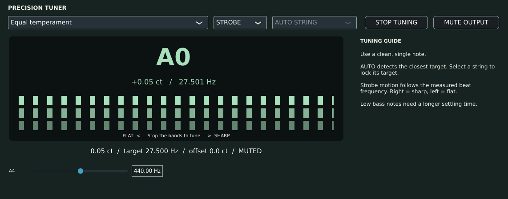
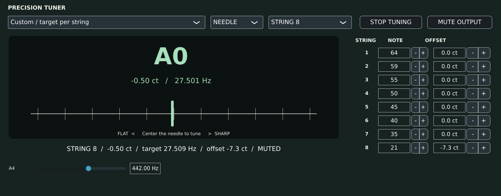
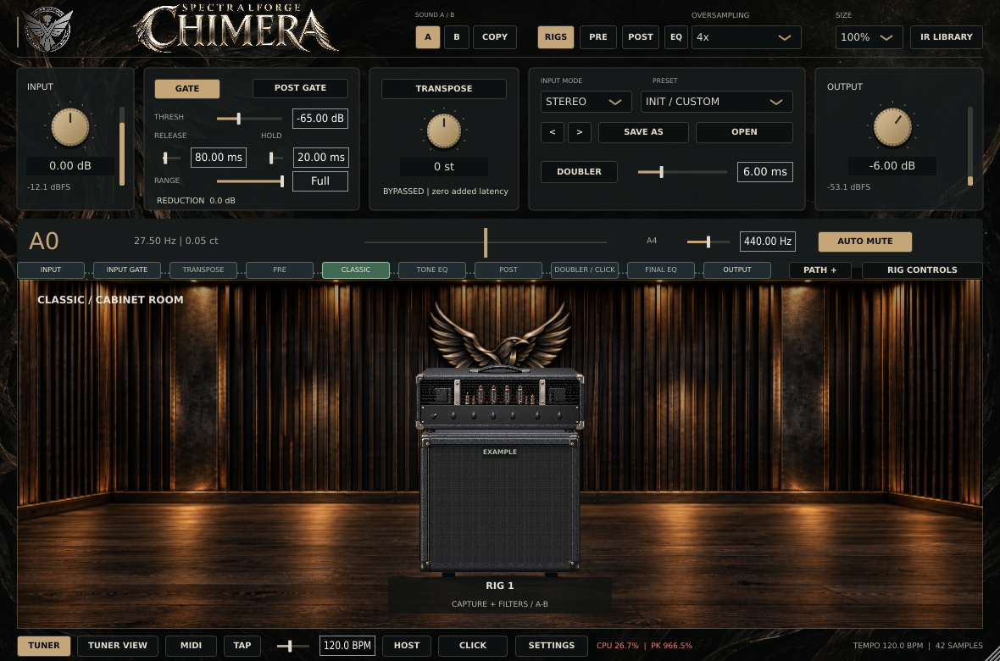

# Tuner evidence — 2026-10-13 UTC

**Disposition: DRAFT / latency qualification FAIL. No release approval.**

The implementation is main-based; the base commit and actual modified source
hashes are recorded in `source-sha256.json`. Local build metadata names the base
commit because compilation occurred before committing. It must not be mistaken
for a clean build of that base. All project and test translation units were
compiled locally; `juce-cache.json` records reuse of unchanged third-party JUCE
objects for the UI harness only.

## Accuracy and response

| Check | Result |
| --- | --- |
| 576 sine/harmonic/noise conditions | PASS; worst absolute error 0.0599684 cent; clean/harmonic limit 0.1, noise limit 0.3 cent |
| 18 weak-fundamental/decay/DC conditions | PASS at 0.1-cent limit |
| 108 frozen-baseline/candidate kernel comparisons | Candidate detected all; maximum 0.002357 cent on these noiseless fixtures |
| Baseline 108 kernel comparisons | 24 misses below its documented 25 Hz range; maximum detected error 4.667442 cents |
| 32 actual decimator/FIFO/worker routes | Accuracy and first acquisition pass; one step-response failure, so aggregate FAIL |
| Candidate final steady worker accuracy | All 32 within 0.1 cent, on synthetic signals and nominal sample clocks |
| Worker lifecycle | Rapid re-enable, stale stream expiry, NaN recovery, sample-rate change and stop completed without assertion |
| Released parameter registration prefix | PASS; old IDs/ranges/defaults/registration code is an exact prefix |
| Address + undefined-behavior sanitizers (kernel) | PASS; leak detection excluded as described below |

| Elapsed time, ms | Baseline median / max | Candidate median / max |
| --- | ---: | ---: |
| First frequency acquisition within 0.5 cent | 202.79 / 262.17 | 176.14 / 197.45 |
| 10-cent step confirmation | 193.44 / 240.07 | 182.12 / **305.65** |

The failing condition is **48 kHz, 256 samples, E2 (82.406889 Hz)**: step
confirmation exceeded the unchanged **290 ms** threshold. That case also recorded
a 16.55 ms elapsed `push()` call. The timing includes possible preemption; this
is evidence of a missed timing gate, **not proof of a scheduler root cause**.
Median improvement does not remove this tail-latency blocker. Do not discard the
case, relax the threshold, or turn a future successful rerun into retroactive
qualification of this run.

`measurements.csv` and `integration.log` are original output of the final native
measurement executable. `summary.json` is derived from that CSV. Fixture 0 is
sine, 1 is sine + second/third harmonics, 2 adds a common exponential amplitude
decay. Each kernel tone is detuned +0.07 cent; `core.log` covers the separate wider
detuning/noise sweep. `99999` marks a no-lock comparison, not a measured cent
error. The worker confidence/compute and baseline kernel compute columns contain
zero placeholders and are not timing/confidence measurements. `push_max_us` is
wall-clock elapsed time, not isolated CPU cost or a callback deadline certificate.

Step confirmation is the first three consecutive audio-block observations within
0.5 cent, plus a final steady-error check. These observations may reuse one worker
estimate; this is not three independent analysis windows or a proof of monotonic
settling. The stepped fixture changes frequency in `sin(2*pi*f*t)` at an
audio-block boundary and therefore includes a phase discontinuity; it is not a
phase-continuous FM benchmark. There is no GUI, physical interface clock, actual
pluck or DAW latency in these response numbers.

## Native UI and host state

The complete native-state test passed on the final production source (44.37 s),
but that run's UI feature test failed to acquire A0 at its fixed 600 ms checkpoint
(`ui-second-attempt.*`). The cause is not established. A separately instrumented
production processor/editor acquired 27.5008 Hz by its 241 ms observation
(`live-diagnostic.cpp` and `.log`); this does not erase the failed run. The UI test
now logs delivered frames and the measured frequency while retaining the same
600 ms wait and 0.1-cent assertion. Its instrumented run passed (14.57 s): at 610.516 ms it had delivered 29,184
frames and measured 27.5008 Hz, confidence 1 (`ui-final.*`). This confirms the
feature path works in that run; the previous intermittent failure remains
unresolved and requires qualification. No production source or assertion
threshold changed between those two runs.

The initial UI feature test passed (15.76 s), including
production A0 measurement, neutral navigation, custom recall and old-state
defaults. The initial full NativeState test failed because its fixed append-only
bank enumerator had no entry for new tuner parameters. The test was extended
with all 19 exact IDs, exact tail indices and AU hint 11; every existing bank
assertion remains intact. `ui-first-attempt.*` preserves that failure.

The screenshot set below was captured by the final instrumented run of the
actual native component, not a design mock.

The editor screenshot reports a 966.5% peak callback-budget reading (elapsed
callback time divided by its block deadline), not whole-machine CPU utilization.
This full-processor run does not isolate tuner cost or establish the cause; it
provides no real-time callback clearance.

No installed Windows/macOS DAW or accessibility acceptance is claimed here.
Three-platform CI is configured; its eventual result must be read for this PR's
exact source, not inherited from the unrelated navigation/tuner draft or PR #60.

## Preserved failures and build environment

- `concurrent-build-attempt.*`: an intermediate source measured during a concurrent
  build missed cold acquisition at 299.05 ms. It stopped early. This is preserved
  separately, not relabeled as the final source's measurements. No source SHA was
  frozen for that intermediate attempt.
- `lsan-environment-failure.log`: LeakSanitizer could not inspect `/proc/.../task`
  in this execution environment. AddressSanitizer and UBSan were then run with
  `ASAN_OPTIONS=detect_leaks=0`; `address-undefined-sanitizers.log` does not claim
  leak or thread-race detection.
- `empty-object-repair.json`: two generated artwork objects were zero bytes and
  caused undefined-symbol link failures. Only those intermediates were removed
  and rebuilt; product code and assertions were not changed for that repair.
- `dependency-repair.json`: after the final UI label edit, CMake's dependency make
  file was empty despite populated compiler dependency records. The two dependent
  production objects were explicitly rebuilt before final UI verification.
- `screenshot-container-repair.json`: the inherited snapshot helper appends when
  the destination already exists. Repeat local runs concatenated two PNGs. The
  final complete PNG was extracted byte-for-byte after chunk CRC validation;
  no pixels were edited or re-encoded. Use a fresh screenshot directory.
- Missing container development headers/link paths and `xkbcomp` required local
  build/display setup. These setup failures are not product test passes. The
  local Xvfb/Openbox desktop used TCP loopback; CI uses the repository's standard
  desktop runner.

## Remaining work

1. Instrument the missed step condition: feeder delivery lateness, queue occupancy
   and discontinuities, analysis start/end, publication generation and GUI age.
   Determine the cause before claiming a fix or certifying the timing gate.
2. Verify real guitar and 5-/6-string bass DI, inharmonicity, attack pitch drift,
   hum/noise/clipping, weak/missing fundamentals and long sustained stability.
3. Complete source-matched Windows/macOS CI and installed AU/VST3/DAW recall;
   qualify physical sample-clock accuracy and audio callback deadlines.
4. Confirm vendor terms and instrument-specific compensated targets before
   commercial branded compatibility claims or additional proprietary profiles.
